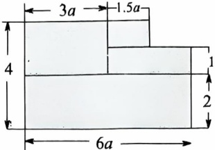

右图是一所住宅的建筑平面图（长度单位：m），用式子表示这所住宅的建筑面积是___m $^{2}$.

> [!question]- 点击查看答案与解析
> 【答案】$2x+3y+12$
> 
> 【考点】列代数式、面积计算 → [[【初中数学知识点体系-人教版】#3-1 列代数式表示数量关系]]
> 
> 【解析】
> 四个区域的面积分别为：
> 卧室：$2\times x=2x$（$\text{m}^2$）
> 客厅：$3\times y=3y$（$\text{m}^2$）
> 厨房：$3\times2=6$（$\text{m}^2$）
> 卫生间：$3\times2=6$（$\text{m}^2$）
> 总面积 $=2x+3y+6+6=2x+3y+12$（$\text{m}^2$）。
> 
> 【易错点】遗漏某个区域面积；矩形面积公式用错。
