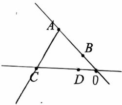

已知：四点 A, B, C, D 的位置如图所示，

(1) 根据下列语句，画出图形.

① 画直线 AB、直线 CD，交点为 O；

② 画射线 AC;

(2) 用适当的语句表述点 A 与直线 CD 的位置关系.

> [!question]- 点击查看答案与解析
> 【答案】见解析
> 
> 【考点】直线、射线画法 → [[【初中数学知识点体系-人教版】#6-2 直线、射线、线段]]
> 
> 【解析】
> (1) $①$ 过 $A$、$B$ 画直线 $AB$，过 $C$、$D$ 画直线 $CD$，两直线交于点 $O$。
> $②$ 以 $A$ 为端点，过 $C$ 画射线 $AC$（向 $C$ 方向无限延伸）。
> (2) 点 $A$ 在直线 $CD$ 外（或点 $A$ 不在直线 $CD$ 上）。
> 
> 【易错点】射线有端点需明确；位置关系表述要准确。
