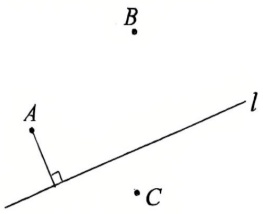
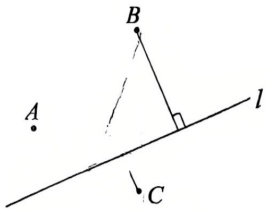

如图，某勘测队在一条近似笔直的河流 l 两边勘测（河宽忽略不计），共设置了 A，B，C 三个勘测点.

图 1

(1) 若勘测队在 A 点建一水池，现将河水引入到水池 A 中，则在河岸的什么位置开沟，才能使水沟的长度最短？请在图 1 中画出图形；你画图的依据是 ___

图 2

(2) 若勘测队在河岸某处开沟，使得该处到勘测点 B，C 所挖水沟的长度之和最短，请在图 2 中画出图形；你画图的依据是 ___。

> [!question]- 点击查看答案与解析
> 【答案】见解析
> 
> 【考点】垂线段最短、两点之间线段最短 → [[【初中数学知识点体系-人教版】#6-2 直线、射线、线段]]
> 
> 【解析】
> (1) 过点 $A$ 作直线 $l$ 的垂线，垂足即为开沟位置。依据：垂线段最短。
> (2) 连接 $BC$，与直线 $l$ 的交点即为开沟位置。依据：两点之间线段最短。
> 
> 【易错点】混淆两种"最短"原理的应用场景。
