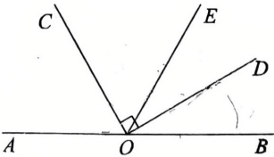

补全解题过程.
已知：如图，O 是直线 AB 上的一点， $\angle COD=90^\circ$，OE 平分  $\angle BOC$。若  $\angle AOC=60^\circ$，求  $\angle DOE$ 的度数；

解：∵O 是直线 AB 上的一点，(已知)

$\therefore\angle BOC=180^{\circ}-\angle AOC.$  (\_\_\_\_\_\_)

∵∠AOC=60°，（已知）

$\therefore \angle BOC = 120^\circ.$  (\_\_\_\_\_\_)

∵OE 平分∠BOC，(已知)

$\therefore\angle COE=\frac{1}{2}\angle BOC.$  (\_\_\_\_\_\_)

$\therefore\angle COE=\underline{\quad}\quad^{\circ},$

∵∠DOE=∠COD-∠COE，且∠COD=90°，

$\therefore\angle DOE=\underline{\quad}\quad^{\circ}$

> [!question]- 点击查看答案与解析
> 【答案】$30°$
> 
> 【考点】平角定义、角平分线 → [[【初中数学知识点体系-人教版】#6-3 角]]
> 
> 【解析】
> $\because O$ 是直线 $AB$ 上的一点（已知）
> $\therefore\angle BOC=180^{\circ}-\angle AOC$（平角的定义）
> $\because\angle AOC=60^{\circ}$（已知）
> $\therefore\angle BOC=120^{\circ}$（等量代换）
> $\because OE$ 平分 $\angle BOC$（已知）
> $\therefore\angle COE=\frac{1}{2}\angle BOC$（角平分线的定义）
> $\therefore\angle COE=60^{\circ}$
> $\because\angle DOE=\angle COD-\angle COE$，且 $\angle COD=90^{\circ}$
> $\therefore\angle DOE=90^{\circ}-60^{\circ}=30^{\circ}$
> 
> 【易错点】角平分线定义不清；角度计算出错。
