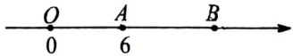

如图，在数轴上有 A, B 两点，且 AB=8，点 A 表示的数为 6；动点 P 从点 O 出发，以每秒 2 个单位长度的速度沿数轴正方向运动，点 Q 从点 A 出发，以每秒 1 个单位长度的速度沿数轴正方向运动，设运动时间为 t 秒.

(1) 写出数轴上点 B 表示的数是 ___；

(2) 当 t=2 时，线段 PQ 的长是 ___；

(3) 当 0 < t < 3 时，则线段 AP = ___；（用含 t 的式子表示）

(4) 当  $PQ = \frac{1}{4} AB$ 时，求 t 的值.

> [!question]- 点击查看答案与解析
> 【答案】(1) $-2$；(2) $4$；(3) $6-2t$；(4) $t=4$ 或 $t=8$
> 
> 【考点】数轴、动点问题 → [[【初中数学知识点体系-人教版】#1-2 有理数及其大小比较]]
> 
> 【解析】
> (1) $A$ 表示 $6$，$AB=8$，$B$ 在 $A$ 左侧，$B$ 表示的数为 $6-8=-2$。
> (2) $t=2$ 时，$P$ 在 $2\times2=4$ 处，$Q$ 在 $6+1\times2=8$ 处，$PQ=|8-4|=4$。
> (3) $0<t<3$ 时，$P$ 在 $2t$ 处（$0<2t<6$），$A$ 在 $6$ 处，$AP=6-2t$。
> (4) $P$ 在 $2t$ 处，$Q$ 在 $6+t$ 处。
> $PQ=|(6+t)-2t|=|6-t|$，$AB=8$，$\frac{1}{4}AB=2$。
> $|6-t|=2$，$6-t=2$ 或 $6-t=-2$。
> $t=4$ 或 $t=8$。
> 
> 【易错点】动点位置表示错误；忽略绝对值的两种情况。
