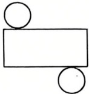

一个几何体的表面展开图如图所示，这个几何体是（）

A. 正方体

B. 三棱锥

C. 四棱锥

D. 圆柱

> [!question]- 点击查看答案与解析
> 【答案】C
> 
> 【考点】几何体的展开图 → [[【初中数学知识点体系-人教版】#6-1 几何图形]]
> 
> 【解析】
> - 选项A：正方体的展开图由6个正方形组成，图中只有5个面，错误；
> - 选项B：三棱锥的展开图由4个三角形组成，错误；
> - 选项C：四棱锥的展开图由1个四边形底面和4个三角形侧面组成，共5个面，与图相符，正确；
> - 选项D：圆柱的展开图由2个圆和1个矩形组成，错误。
> 
> 【易错点】混淆各种几何体展开图的特征，注意数面的个数和形状。
