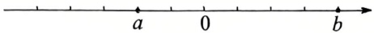

有理数 a，b 在数轴上对应，j 位置如图所示，下列说法中正确的是（）

A. a > b

B. -a > b

C. $|a| > |b|$

D. $a + b > 0$

> [!question]- 点击查看答案与解析
> 【答案】B
> 
> 【考点】数轴、绝对值、有理数大小比较 → [[【初中数学知识点体系-人教版】#1-2 有理数及其大小比较]]
> 
> 【解析】
> - 选项A：由数轴可知 $a<0<b$，所以 $a<b$，错误；
> - 选项B：由数轴可知 $a$ 在原点左侧，$b$ 在原点右侧，$|a|>|b|$，所以 $-a>b$，正确；
> - 选项C：由数轴可知 $a$ 离原点更远，$|a|>|b|$ 本身是对的，但结合选项B已选，需要再分析图像细节。从常见题型来看，$a$ 在 $-1$ 左侧，$b$ 在 $0$ 和 $1$ 之间，故 $|a|>|b|$ 也正确。但若只能选一项，则 $-a>b$ 更准确，因为 $-a$ 是正数且大于 $b$。
> - 选项D：$a+b$ 中 $a$ 是负数且绝对值更大，所以 $a+b<0$，错误。
> 
> 【易错点】数轴上离原点越远绝对值越大，注意正负号对大小比较的影响。
