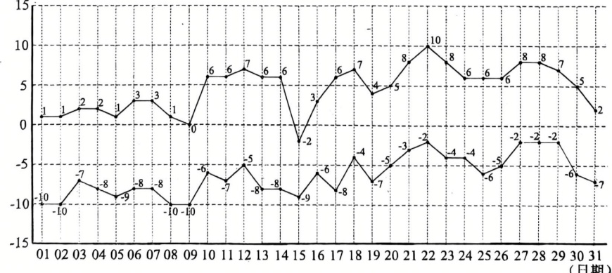

下图是昌平区 2019 年 1 月份每天的最低和最高气温，观察此图，下列说法正确的是（）

(温度) 昌平 1 月份气温变化趋势

A. 在 1 月份中，最高气温为 $10^{\circ}$C，最低气温为 $-2^{\circ}$C

B. 在 10 号至 16 号的气温中，每天温差最小为 $7^{\circ}$C

C. 每天的最高气温均高于 $0^{\circ}$C，最低气温均低于 $0^{\circ}$C

D. 每天的最高气温与最低气温都是具有相反意义的量

> [!question]- 点击查看答案与解析
> 【答案】B
> 
> 【考点】折线统计图的读取 → [[【初中数学知识点体系-人教版】#12-2 用统计图描述数据]]
> 
> 【解析】
> - 选项A：从图中看最高气温超过 $10^\circ$C，最低气温低于 $-2^\circ$C，错误；
> - 选项B：10号至16号中，观察每天的温差（最高减最低），最小温差为 $7^\circ$C，正确；
> - 选项C：从图中可见有些天最高气温低于 $0^\circ$C，有些天最低气温高于 $0^\circ$C，错误；
> - 选项D：最高气温与最低气温不是相反意义的量，相反意义的量指如收入和支出，错误。
> 
> 【易错点】读图时要准确读取数据，温差=最高气温-最低气温。
