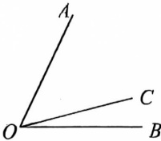

如图，已知 $\angle AOC = 50^\circ 30'$， $\angle BOC = 14^\circ 18'$，则 $\angle AOB =$ ___。

> [!question]- 点击查看答案与解析
> 【答案】$36^\circ 12'$
> 
> 【考点】角度的计算 → [[【初中数学知识点体系-人教版】#6-3 角]]
> 
> 【解析】
> 由图可知 $\angle AOB = \angle AOC - \angle BOC = 50^\circ 30' - 14^\circ 18' = 36^\circ 12'$。
> 
> 【易错点】角度相减时注意借位，$1^\circ=60'$。
