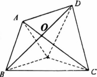

如图，在四边形 ABCD 内找一点 O，使它到四边形四个顶点的距离之和 $OA + OB + OC + OD$ 最小，正确的作法是连接 AC、BD 交于点 O，则点 O 就是要找的点，请你用所学过的数学知识解释这一道理 ___.

> [!question]- 点击查看答案与解析
> 【答案】两点之间线段最短
> 
> 【考点】线段的性质 → [[【初中数学知识点体系-人教版】#6-2 直线、射线、线段]]
> 
> 【解析】
> 连接 $AC$、$BD$ 交于点 $O$，对四边形内任意一点 $P$，由三角形三边关系可知 $PA+PC\ge AC=OA+OC$，$PB+PD\ge BD=OB+OD$，所以 $OA+OB+OC+OD$ 最小。依据是"两点之间线段最短"。
> 
> 【易错点】不理解为什么对角线交点到四个顶点距离之和最小。
