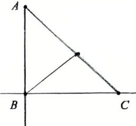

如图：A, B, C 是平面上三个点，按下列要求画出图形.

(1) 作直线 BC，射线 AB，线段 AC.

(2) 取 AC 中点 D，连接 BD，量出 $\angle ACB$ 的度数 (精确到个位)

(3) 通过度量猜想 BD 和 AC 的数量关系.

> [!question]- 点击查看答案与解析
> 【答案】见解析
> 
> 【考点】直线、射线、线段的画法 → [[【初中数学知识点体系-人教版】#6-2 直线、射线、线段]]
> 
> 【解析】
> (1) 直线 $BC$ 过 $B$、$C$ 两点向两端无限延伸；射线 $AB$ 以 $A$ 为端点经过 $B$ 向一方延伸；线段 $AC$ 连接 $A$、$C$ 两点。
> 
> (2) 取 $AC$ 中点 $D$（用刻度尺量取或圆规作图），连接 $BD$，用量角器量出 $\angle ACB$ 的度数（约为图中实际角度）。
> 
> (3) 通过度量发现 $BD\approx\frac{1}{2}AC$ 或其他数量关系（根据具体图形）。
> 
> 【易错点】直线、射线、线段的概念混淆，直线两端无限延伸，射线一端无限延伸，线段有固定长度。
