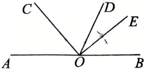

如图：O 是直线 AB 上一点， $\angle AOC = 50^\circ$, OD 是 $\angle BOC$ 的角平分线， $OE \perp OC$ 于点 O。求 $\angle DOE$ 的度数。（请补全下面的解题过程）

解：∵O 是直线 AB 上一点，∠AOC=50°，

$\therefore\angle BOC=180^{\circ}-\angle AOC=$ ___.

∵ OD 是 ∠BOC 的角平分线，

$\therefore\angle COD=\underline{\quad}\angle BOC.$ (\_\_\_\_\_)

$\therefore\angle COD=65^{\circ}.$

∵ $OE \perp OC$ 于点 O，（已知）.

$\therefore \angle COE = \_\_\_\_\_\_^\circ.$

$\therefore\angle DOE=\angle COE-\angle COD=\underline{\quad}\text{。}$

> [!question]- 点击查看答案与解析
> 【答案】$25^\circ$
> 
> 【考点】角的平分线、补角、垂直 → [[【初中数学知识点体系-人教版】#6-3 角]]
> 
> 【解析】
> ∵ $O$ 是直线 $AB$ 上一点，$\angle AOC=50^\circ$，
> $\therefore\angle BOC=180^\circ-\angle AOC=130^\circ$。
> 
> ∵ $OD$ 是 $\angle BOC$ 的角平分线，
> $\therefore\angle COD=\frac{1}{2}\angle BOC$（角平分线的定义）。
> $\therefore\angle COD=65^\circ$。
> 
> ∵ $OE\perp OC$ 于点 $O$（已知），
> $\therefore\angle COE=90^\circ$。
> 
> $\therefore\angle DOE=\angle COE-\angle COD=90^\circ-65^\circ=25^\circ$。
> 
> 【易错点】没有正确理解角平分线的定义，以及 $\angle DOE$ 与 $\angle COE$、$\angle COD$ 的关系。
