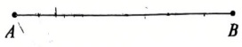

已知线段 AB，点 C 在直线 AB 上，D 为线段 BC 的中点.

(1) 若 AB = 8，AC = 2，求线段 CD 的长.

(2) 若点 E 是线段 AC 的中点，直接写出线段 DE 和 AB 的数量关系是 ___.

> [!question]- 点击查看答案与解析
> 【答案】(1) 3或5；(2) $DE=\frac{1}{2}AB$
> 
> 【考点】线段的中点、线段的和差 → [[【初中数学知识点体系-人教版】#6-2 直线、射线、线段]]
> 
> 【解析】
> (1) 点 $C$ 在直线 $AB$ 上，分两种情况：
> 
> 情况一：$C$ 在 $A$、$B$ 之间。
> $BC=AB-AC=8-2=6$。
> ∵ $D$ 为 $BC$ 中点，$\therefore CD=\frac{1}{2}BC=3$。
> 
> 情况二：$C$ 在 $A$ 的左侧（$A$ 在 $C$、$B$ 之间）。
> $BC=AB+AC=8+2=10$。
> ∵ $D$ 为 $BC$ 中点，$\therefore CD=\frac{1}{2}BC=5$。
> 
> 综上，$CD$ 的长为3或5。
> 
> (2) $DE=\frac{1}{2}AB$。
> 
> 理由：设 $AC=x$，则 $BC=AB-AC=8-x$（$C$ 在 $A$、$B$ 之间时）或 $BC=AB+AC=8+x$（$C$ 在 $A$ 左侧时）。
> $E$ 是 $AC$ 中点，$AE=\frac{x}{2}$。
> $D$ 是 $BC$ 中点，$CD=\frac{BC}{2}$。
> 
> 当 $C$ 在 $A$、$B$ 之间时：$DE=EC+CD=\frac{x}{2}+\frac{8-x}{2}=\frac{8}{2}=4=\frac{1}{2}AB$。
> 当 $C$ 在 $A$ 左侧时：$DE=CD-EC=\frac{8+x}{2}-\frac{x}{2}=\frac{8}{2}=4=\frac{1}{2}AB$。
> 
> 综上，$DE=\frac{1}{2}AB$。
> 
> 【易错点】点 $C$ 在直线 $AB$ 上有两种位置情况，容易漏解。
