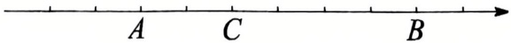

如图所示，点 A, B, C 是数轴上的三个点，其中 AB=12，且 A, B 两点表示的数互为相反数.

(1) 请在数轴上标出原点 O，并写出点 A 表示的数；

(2) 如果点 Q 以每秒 2 个单位的速度从点 B 出发向左运动，那么经过 ___ 秒时，点 C 恰好是 BQ 的中点；

(3) 如果点 P 以每秒 1 个单位的速度从点 A 出发向右运动，那么经过多少秒时 PC=2PB.

> [!question]- 点击查看答案与解析
> 【答案】(1) 原点 $O$ 在 $A$、$B$ 中点，$A$ 表示 $-6$；(2) 8；(3) 20或$\frac{28}{3}$
> 
> 【考点】数轴、相反数、动点问题 → [[【初中数学知识点体系-人教版】#1-2 有理数及其大小比较]]
> 
> 【解析】
> (1) ∵ $A$、$B$ 两点表示的数互为相反数，且 $AB=12$，
> ∴ 原点 $O$ 是 $AB$ 的中点，$A$ 表示的数为 $-6$，$B$ 表示的数为 $6$。
> 
> (2) 由图可知 $C$ 在原点左侧，设 $C$ 表示的数为 $c$。
> 点 $Q$ 从 $B(6)$ 出发向左运动，$t$ 秒后 $Q$ 表示的数为 $6-2t$。
> $C$ 是 $BQ$ 的中点，则 $c=\frac{6+(6-2t)}{2}=\frac{12-2t}{2}=6-t$。
> 由图可知 $C$ 表示的数为 $-2$。
> $-2=6-t$，解得 $t=8$。
> 
> (3) 点 $P$ 从 $A(-6)$ 出发向右运动，$t$ 秒后 $P$ 表示的数为 $-6+t$。
> $PC=|(-6+t)-(-2)|=|t-4|$，$PB=|(-6+t)-6|=|t-12|$。
> 
> 由 $PC=2PB$：$|t-4|=2|t-12|$。
> 
> 情况一：$t-4=2(t-12)$，$t-4=2t-24$，$t=20$。
> 情况二：$t-4=-2(t-12)$，$t-4=-2t+24$，$3t=28$，$t=\frac{28}{3}$。
> 
> 验证：$t=20$ 时，$P$ 表示 $14$，$PC=|14-(-2)|=16$，$PB=|14-6|=8$，$16=2\times 8$，成立。
> $t=\frac{28}{3}$ 时，$P$ 表示 $\frac{10}{3}$，$PC=|\frac{10}{3}+2|=\frac{16}{3}$，$PB=|\frac{10}{3}-6|=\frac{8}{3}$，$\frac{16}{3}=2\times\frac{8}{3}$，成立。
> 
> 所以经过 $20$ 秒或 $\frac{28}{3}$ 秒。
> 
> 【易错点】动点问题要正确表示运动后的位置，绝对值方程要分类讨论。
