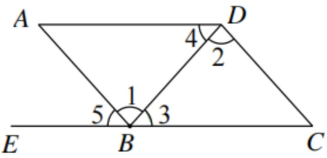

如图，下列条件中，能判断 $AD \parallel BC$ 的是

A. $\angle 3 = \angle 4$

B. $\angle 1 = \angle 2$

C. $\angle 5 = \angle C$

D. $\angle A + \angle ADC = 180^\circ$

> [!question]- 点击查看答案与解析
> 【答案】A
> 
> 【解析】要判断 $AD \parallel BC$，需要找到与 $AD$、$BC$ 相关的同位角、内错角或同旁内角。
> - $\angle 3$ 和 $\angle 4$ 是直线 $AD$、$BC$ 被 $AC$ 所截形成的内错角，$\angle 3 = \angle 4 \Rightarrow AD \parallel BC$（内错角相等，两直线平行）
> - B：$\angle 1 = \angle 2$ 可判定 $AB \parallel CD$
> - C：$\angle 5 = \angle C$ 可判定 $AB \parallel CD$
> - D：$\angle A + \angle ADC = 180^\circ$ 可判定 $AB \parallel CD$
> 
> 【考点】平行线的判定与性质 — 平行线的判定 → [[【初中数学知识点体系-人教版】#7-2 平行线]]
