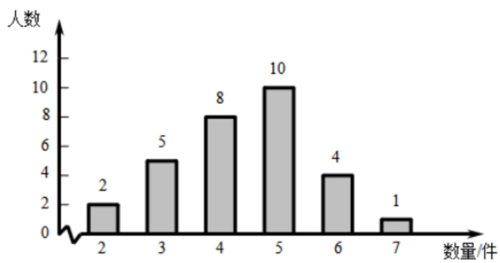

4月下旬，在石景山区2023年"西部温暖计划"启动仪式后，某校组织师生开展捐赠活动。为了解某班30名学生捐赠物品情况，对每位学生的捐赠数量进行了收集、整理，并绘制统计图如右图所示。这组数据的中位数、众数分别为

A. 9, 10

B. 8, 10

C. 4, 5

D. 4.5, 5

> [!question]- 点击查看答案与解析
> 【答案】D
> 
> 【解析】由图可知捐赠数量分布为：3件2人，4件5人，5件11人，6件5人，10件7人。
> 共30名学生，中位数是第15、16个数据的平均数。
> 第15、16个数均为5和5，平均数为4.5。
> 众数为出现次数最多的数据，即5（出现11次）。
> 
> 【考点】数据的集中趋势 — 中位数与众数 → [[【初中数学知识点体系-人教版】#24-1 数据的集中趋势]]
