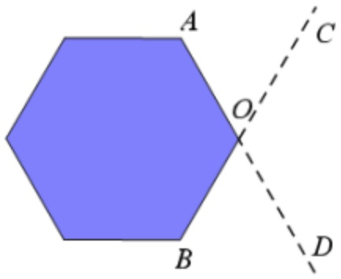

为了测量一座古塔外墙底部的角（如右图 $\angle AOB$）的度数，丁洋同学设计了如下测量方案：作 AO，BO 的延长线 OD，OC，量出 $\angle COD$ 的度数，即为 $\angle AOB$ 的度数. 这样设计的依据是 ___ .

> [!question]- 点击查看答案与解析
> 【答案】对顶角相等
> 
> 【解析】$\angle AOB$ 与 $\angle COD$ 是对顶角，根据"对顶角相等"可知 $\angle AOB = \angle COD$，因此测量 $\angle COD$ 即可得到 $\angle AOB$ 的度数。
> 
> 【考点】相交线与对顶角 — 对顶角的性质 → [[【初中数学知识点体系-人教版】#7-1 相交线]]
