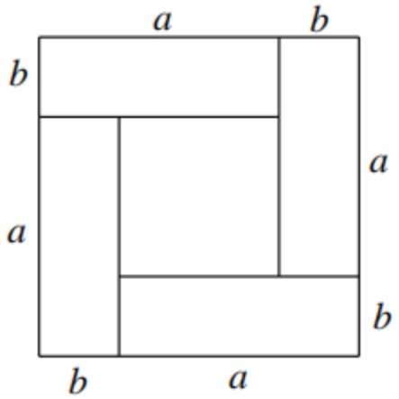

著名数学家华罗庚曾用诗词表达了"数形结合"的思想，其中谈到"数缺形时少直观，形少数时难入微". 右图是由四个长为 a，宽为 b 的长方形拼摆而成的正方形，其中 $a>b>0$。根据图形写出一个正确的等式，可以表示为 ___ 。

> [!question]- 点击查看答案与解析
> 【答案】$(a+b)^{2}=(a-b)^{2}+4ab$
> 
> 【解析】大正方形边长为 $a+b$，面积为 $(a+b)^{2}$。
> 中间小正方形边长为 $a-b$，面积为 $(a-b)^{2}$。
> 四个长方形总面积 $4ab$。
> $(a+b)^{2} = (a-b)^{2} + 4ab$
> 
> 【考点】整式的乘法与因式分解 — 完全平方公式的几何意义 → [[【初中数学知识点体系-人教版】#16-3 乘法公式]]
