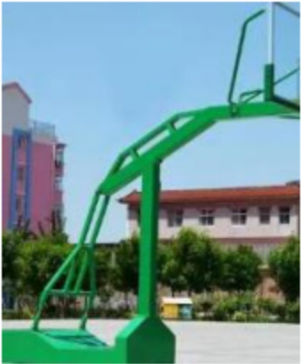
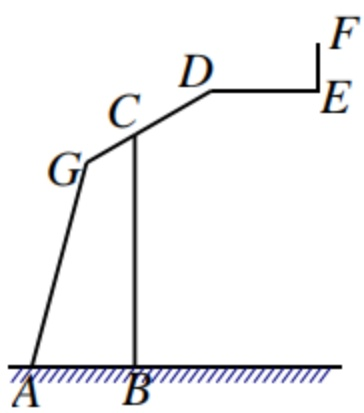

某篮球架及侧面示意图如右图所示. 若 $\angle EDC=150^\circ$，$DE \parallel AB$，$CB \perp AB$ 于点 $B$，则 $\angle GCB=$ ___ ° .

> [!question]- 点击查看答案与解析
> 【答案】$60^\circ$
> 
> 【解析】$\because DE \parallel AB$，$\therefore \angle EDC + \angle DAB = 180^\circ$（两直线平行，同旁内角互补）
> $\therefore \angle DAB = 180^\circ - 150^\circ = 30^\circ$
> $\because CB \perp AB$，$\therefore \angle ABC = 90^\circ$
> 在 $\triangle ABC$ 中，$\angle ACB = 90^\circ - 30^\circ = 60^\circ$
> $\angle GCB = \angle ACB = 60^\circ$
> 
> 【考点】平行线的判定与性质 — 平行线性质与垂直的综合应用 → [[【初中数学知识点体系-人教版】#7-2 平行线]]
