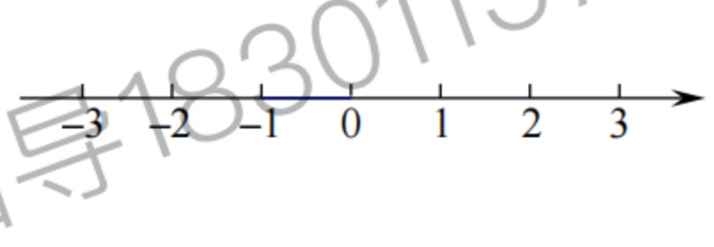

解不等式组 $\begin{cases} 5(x-1) \leq x+3, \\ \frac{x+1}{2}<2x. \end{cases}$

> [!question]- 点击查看答案与解析
> 【答案】$\frac{1}{3}<x\leq2$
> 
> 【解析】
> 解不等式 $①$：$5(x-1) \leq x+3 \Rightarrow 5x-5 \leq x+3 \Rightarrow 4x \leq 8 \Rightarrow x \leq 2$
> 解不等式 $②$：$\frac{x+1}{2} < 2x \Rightarrow x+1 < 4x \Rightarrow 1 < 3x \Rightarrow x > \frac{1}{3}$
> $\therefore$ 不等式组的解集为 $\frac{1}{3} < x \leq 2$
> 
> 【考点】一元一次不等式（组）— 解不等式组及数轴表示 → [[【初中数学知识点体系-人教版】#11-3 一元一次不等式组]]
