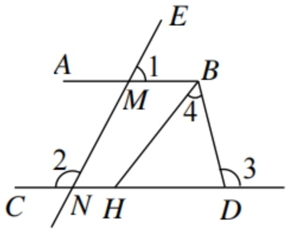

已知：如图，直线 $AB$，$CD$ 与直线 $EF$ 分别交于点 $M$，$N$，$\angle 1 + \angle 2 = 180^\circ$，$BH$ 平分 $\angle ABD$，交 $CD$ 于点 $H$。

求证：$\angle4=\frac{1}{2}\angle3$．

请补全下面的证明过程：

证明：$\because \angle1+\underline{①}=180^{\circ}$（平角的定义），

$\angle1+\angle2=180^{\circ}$（已知），

$\therefore \underline{②}=\angle2$（$③$），

$\therefore$AB∥CD（同位角相等，两直线平行）.

$\therefore \angle ABD=\angle3$（$④$）.

$\because$BH 平分 $\angle ABD$（已知），

$\therefore \underline{⑤}$（角平分线的定义）.

$\therefore \angle 4 = \frac{1}{2} \angle 3 \quad (\text{⑥})$

> [!question]- 点击查看答案与解析
> 【答案】$①$ $\angle AME$；$②$ $\angle AME$；$③$ 同角的补角相等；$④$ 两直线平行，内错角相等；$⑤$ $\angle4=\frac{1}{2}\angle ABD$；$⑥$ 等量代换
> 
> 【解析】
> $①$ $\because \angle1+\angle AME=180^{\circ}$（平角的定义）
> $②$ $\therefore \angle AME = \angle2$（$③$ 同角的补角相等）
> $\therefore$ AB∥CD（同位角相等，两直线平行）
> $\therefore \angle ABD = \angle3$（$④$ 两直线平行，内错角相等）
> $\because$ BH平分$\angle ABD$，$\therefore \angle4 = \frac{1}{2}\angle ABD$（$⑤$ 角平分线的定义）
> $\therefore \angle4 = \frac{1}{2}\angle3$（$⑥$ 等量代换）
> 
> 【考点】平行线的判定与性质 — 平行线的判定与性质综合 → [[【初中数学知识点体系-人教版】#7-2 平行线]]
