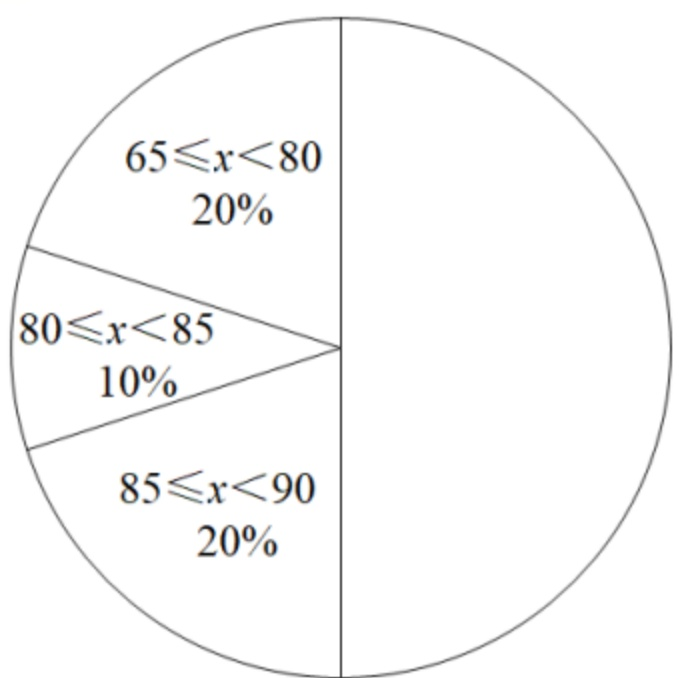

2023年5月8日是第76个世界红十字日。某校以"生命教育'救'在身边"为主题开展"红十字博爱周"活动。为了增强学生的急救意识，宣传急救知识，对七年级200名学生开展急救知识竞赛。为了解七年级学生急救知识掌握情况，调查小组进行了抽样调查，过程如下：

**收集数据** 调查小组计划从七年级选取20名学生的竞赛成绩（百分制）作为样本，下面的抽样方法中，合理的是 ___（填字母）.

A. 从七年级的救护技能培训班中选取20名学生的竞赛成绩组成样本；
B. 从七年级选取20名女生的竞赛成绩组成样本；
C. 从七年级随机选取20名学生的竞赛成绩组成样本.

抽样方法确定后，调查小组抽取得到七年级的样本数据如下：

68 88 84 78 92 83 95 88 100 92
86 95 79 76 99 97 88 93 99 100

**整理、描述数据** 按如下分数段整理、描述样本数据：

**七年级样本成绩统计表**

| 成绩x（单位：分） | 划记 | 频数 |
|-----------------|------|------|
| 65≤x<80 | | |
| 80≤x<85 | T | 2 |
| 85≤x<90 | 正 | 4 |
| 90≤x<95 | | |
| 95≤x≤100 | 正T | 7 |

**七年级样本成绩统计图**

**解决问题**

（1）请将统计表、扇形统计图补充完整；

（2）估计该校七年级学生竞赛成绩不低于 90 分的学生有 ___ 名.

> [!question]- 点击查看答案与解析
> 【答案】抽样方法：C
> 
> （1）补充统计表：
> 
> | 成绩x（单位：分） | 划记 | 频数 |
> |-----------------|------|------|
> | 65≤x<80 | 丅 | 4 |
> | 80≤x<85 | T | 2 |
> | 85≤x<90 | 正 | 4 |
> | 90≤x<95 | 丅 | 3 |
> | 95≤x≤100 | 正T | 7 |
> 
> （2）不低于90分的人数：$\frac{3+7}{20} \times 200 = 100$ 名
> 
> 【解析】样本数据共20个，合理抽样方法为C（随机抽样）。
> 成绩不低于90分（即90≤x≤100）的频数为 $3+7=10$，占比 $\frac{10}{20}=50\%$。
> 估计全校200人中，$200 \times 50\% = 100$ 人。
> 
> 【考点】数据的收集与整理 — 抽样调查、频数分布、用样本估计总体 → [[【初中数学知识点体系-人教版】#12-1 统计调查]]
