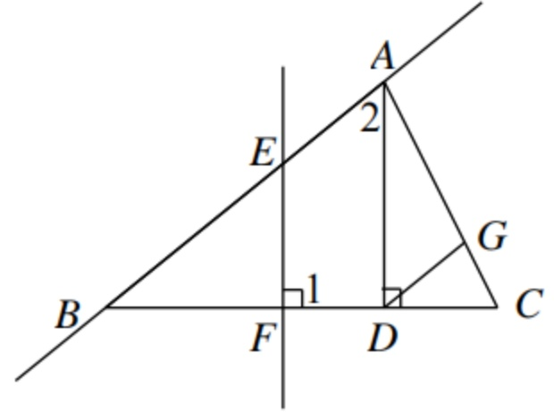

如图1，AC，BC 被 AB 所截，AD⊥BC 于点 D. E 为直线 AB 上一点（与点A，B不重合），过点 E 作 BC 的垂线，垂足为 F，过点 D 作 DG//AB 交 AC 于点 G.

图1 图2

（1）若点 E 在线段 AB 上，如图 2 所示.

$①$ 根据题意补全图形；

$②$ 判断 $\angle AEF$ 与 $\angle ADG$ 的数量关系，并证明；

（2）若点 E 不在线段 AB 上，直接写出 $\angle AEF$ 与 $\angle ADG$ 的数量关系为 ___ ；

（3）通过本题前两问的解决，观察 $\angle AEF$ 与 $\angle ADG$ 的位置关系和数量关系，归纳出一个你发现的结论.

> [!question]- 点击查看答案与解析
> 【答案】（1）$②$ $\angle AEF + \angle ADG = 180^\circ$
> （2）$\angle AEF = \angle ADG$
> （3）如果两个角的两边分别平行，那么这两个角相等或互补
> 
> 【解析】
> （1）$②$ 证明：
> $\because EF \perp BC$，$AD \perp BC$
> $\therefore \angle EFC = \angle ADC = 90^\circ$
> $\therefore EF \parallel AD$（同位角相等，两直线平行）
> $\therefore \angle AEF + \angle EAD = 180^\circ$（两直线平行，同旁内角互补）
> $\because DG \parallel AB$
> $\therefore \angle ADG = \angle EAD$（两直线平行，内错角相等）
> $\therefore \angle AEF + \angle ADG = 180^\circ$（等量代换）
> 
> （2）当点E不在线段AB上时，$\angle AEF = \angle ADG$（通过画图可知）
> 
> （3）如果两个角的两边分别平行，那么这两个角相等或互补
> 
> 【考点】平行线的判定与性质 — 平行线综合探究 → [[【初中数学知识点体系-人教版】#7-2 平行线]]
