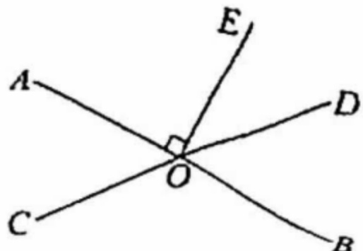

如图，直线 $AB$，$CD$ 相交于点 $O$，$EO \perp AB$，垂足为 $O$，$\angle DOE=37^{\circ}$，$\angle COB$ 的大小是

A. $53^{\circ}$

B. $143^{\circ}$

C. $117^{\circ}$

D. $127^{\circ}$

> [!question]- 点击查看答案与解析
> 【答案】D
> 【解析】$\because EO \perp AB$，$\therefore \angle EOB = 90^{\circ}$。$\because \angle DOE = 37^{\circ}$，$\therefore \angle DOB = 90^{\circ} - 37^{\circ} = 53^{\circ}$。$\because \angle COB$ 与 $\angle DOB$ 互补，$\therefore \angle COB = 180^{\circ} - 53^{\circ} = 127^{\circ}$。
> 【考点】对顶角、垂线 → [[【初中数学知识点体系-人教版】#7-1 相交线]]
