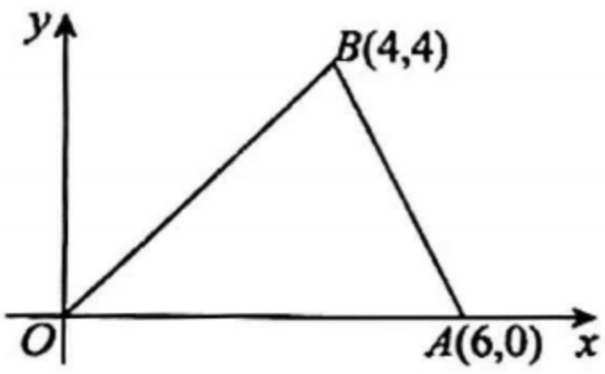
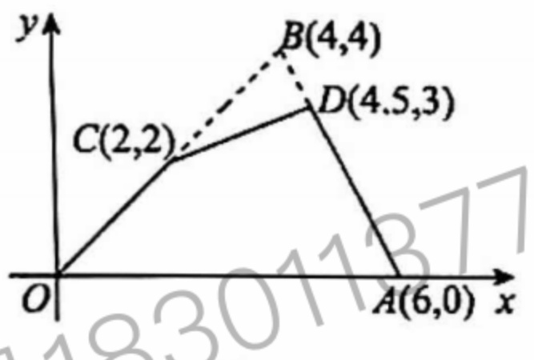
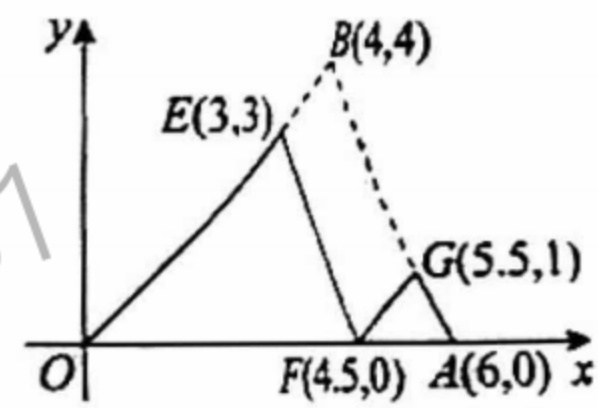

以某公园西门 O 为原点建立平面直角坐标系，东门 A 和景点 B 的坐标分别是（6，0）和（4，4）。如图 1，甲的游览路线是：$O \rightarrow B \rightarrow A$，其折线段的路程总长记为 $l_{1}$。如图 2，景点 C 和 D 分别在线段 OB，BA 上，乙的游览路线是：$O \rightarrow C \rightarrow D \rightarrow A$，其折线段的路程总长记为 $l_{2}$。如图 3，景点 E 和 G 分别在线段 OB，BA 上，景点 F 在线段 OA 上，丙的游览路线是：$O \rightarrow E \rightarrow F \rightarrow G \rightarrow A$，其折线段的路程总长记为 $l_{3}$。下列 $l_{1}$，$l_{2}$，$l_{3}$ 的大小关系正确的是

图1

图2

图3

A. $l_{1}=l_{2}=l_{3}$

B. $l_{1}<l_{2}$ 且 $l_{2}=l_{3}$

C. $l_{2}<l_{1}<l_{3}$

D. $l_{1}>l_{2}$ 且 $l_{1}=l_{3}$

> [!question]- 点击查看答案与解析
> 【答案】D
> 【解析】利用"两点之间线段最短"的原理，折线路径中，中间点在线段上时，折线总长等于直接路径长。$l_1 = OB + BA$，$l_2 = OC + CD + DA$，$l_3 = OE + EF + FG + GA$。由于 C、D 分别在线段 OB、BA 上，$OC + CD + DA < OB + BA$，即 $l_2 < l_1$。而 E、F、G 分别在 OB、OA、BA 上，$OE + EF + FG + GA = OB + BA$，即 $l_3 = l_1$。故 $l_2 < l_1$ 且 $l_1 = l_3$。
> 【考点】坐标与路径比较 → [[【初中数学知识点体系-人教版】#9-2 坐标方法的简单应用]]
