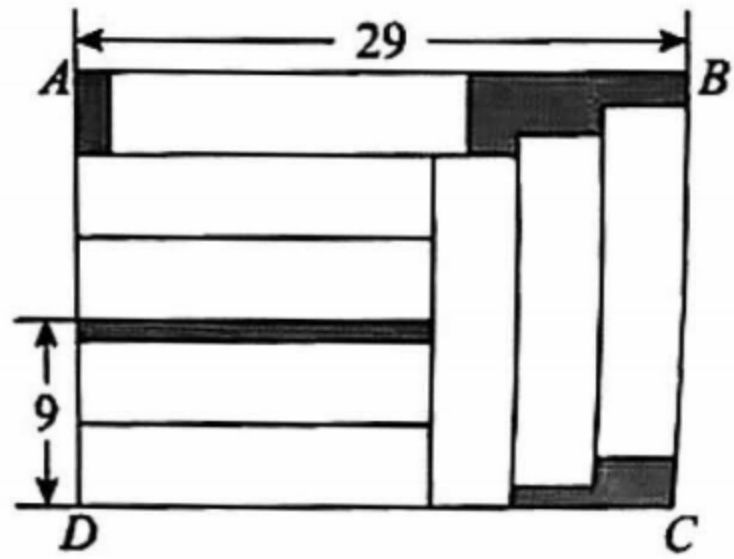

有 8 张形状、大小完全相同的小长方形卡片，将它们按如图所示的方式（不重叠）放置在大长方形 $ABCD$ 中，根据图中标出的数据，1 张小长方形卡片的面积是

A. 72

B. 68

C. 64

D. 60

> [!question]- 点击查看答案与解析
> 【答案】B
> 【解析】设小长方形卡片的宽为 $x$，长为 $y$。由图中数据可得：$\begin{cases} 3x + y = 20 \\ x + 2y = 28 \end{cases}$，解得 $\begin{cases} x = 4 \\ y = 17 \end{cases}$（舍去，与实际不符）。重新列式：$\begin{cases} y + 3x = 20 \\ 2y + x = 28 \end{cases}$，解得 $\begin{cases} x = 4 \\ y = 17 \end{cases}$，面积 $= 4 \times 17 = 68$。
> 【考点】面积问题 → [[【初中数学知识点体系-人教版】#10-3 实际问题与二元一次方程组]]
