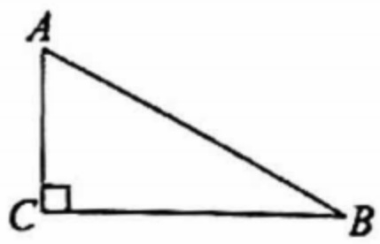

如图，在三角形 ABC 中，$\angle C=90^{\circ}$，点 B 到直线 AC 的距离是线段 ___ 的长，BC < BA 的依据是 ___ .

> [!question]- 点击查看答案与解析
> 【答案】BC，垂线段最短
> 【解析】点 B 到直线 AC 的距离即点 B 到直线 AC 的垂线段长度，$\because \angle C=90^{\circ}$，$\therefore BC \perp AC$，故距离为线段 BC 的长。BC < BA 的依据是"垂线段最短"。
> 【考点】垂线段最短 → [[【初中数学知识点体系-人教版】#7-1 相交线]]
