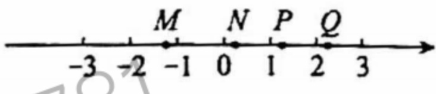

点 M, N, P, Q 在数轴上的位置如图所示，这四个点中有一个点表示实数 $\sqrt{5}-1$，这个点是 ___ .

> [!question]- 点击查看答案与解析
> 【答案】点 P
> 【解析】$\sqrt{5} \approx 2.236$，$\sqrt{5}-1 \approx 1.236$，在数轴上位于 1 到 2 之间，对应点 P。
> 【考点】实数与数轴 → [[【初中数学知识点体系-人教版】#8-3 实数及其简单运算]]
