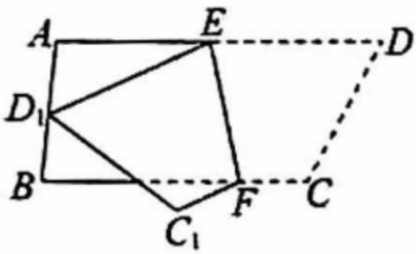

如图，四边形纸片 ABCD，AD//BC. 折叠纸片 ABCD，使点 D 落在 AB 上的点 $D_{1}$ 处，点 C 落在点 $C_{1}$ 处，折痕为 EF. 若 $\angle EFC=102^{\circ}$，则 $\angle AED_{1}=$ ___ °.

> [!question]- 点击查看答案与解析
> 【答案】24
> 【解析】由折叠性质，$\angle EFC = \angle EFC_1 = 102^{\circ}$。$\because AD // BC$，$\therefore \angle EFC + \angle FED = 180^{\circ}$，$\therefore \angle FED = 78^{\circ}$。由折叠性质，$\angle FED = \angle FED_1 = 78^{\circ}$。$\therefore \angle AED_1 = 180^{\circ} - 78^{\circ} \times 2 = 24^{\circ}$。
> 【考点】平行线的性质与折叠 → [[【初中数学知识点体系-人教版】#7-2 平行线]]
