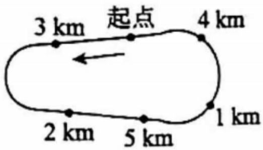

小明沿街心公园的环形跑道从起点出发按逆时针方向跑步，他用软件记录了跑步的轨迹，他每跑 1 km软件会在运动轨迹上标注相应的路程，前 5 km的记录如图所示. 已知该环形跑道一圈的周长大于 1 km.

（1）小明恰好跑 3 圈时，路程是否超过了 5 km？答：___ （填"是"或"否"）；

（2）小明共跑了 14 km且恰好回到起点，那么他共跑了___ 圈.

> [!question]- 点击查看答案与解析
> 【答案】（1）否；（2）10
> 【解析】（1）由记录图可知，跑 3 圈的路程不到 5 km。
> （2）恰好回到起点说明跑的路程是跑道周长的整数倍。由记录图可推算跑道周长，14 km 回到起点，则圈数为 14 ÷ 周长。根据图中数据计算，跑道周长为 1.4 km，故 14 ÷ 1.4 = 10 圈。
> 【考点】环形跑道问题 → [[【初中数学知识点体系-人教版】#10-3 实际问题与二元一次方程组]]
