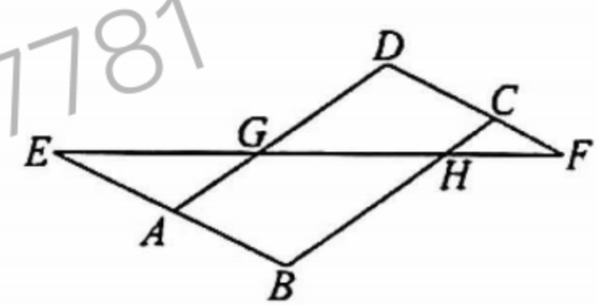

如图，点 E，F 分别在 BA，DC 的延长线上，直线 EF 分别交 AD，BC 于点 G，H，$\angle B=\angle D,\quad\angle E=\angle F.$ 
求证：$\angle EGA + \angle CHG = 180^{\circ}$

请将下面的证明过程补充完整：

证明：$\because \angle E = \angle F$，

$\therefore \underline{\quad} // \underline{\quad}.$

$\therefore \angle D = \angle \_\_\_$. ( ___ ) (填推理的依据)

 $\because\angle B=\angle D,$ 
 
 $\therefore\angle B=\angle \_\_\_.$
 
 $\therefore \_\_\_ // \_\_\_.$（ ___ ）（填推理的依据）
 
$\therefore\angle DGH+\angle CHG=180^{\circ}$ 

$\because \angle DGH = \angle EGA,$ （ ___ ）（填推理的依据）

$\therefore\angle EGA+\angle CHG=180^{\circ}$

> [!question]- 点击查看答案与解析
> 【答案】
> 证明：$\because \angle E = \angle F$，
> 
> $\therefore \underline{AB} \parallel \underline{DF}$.
> 
> $\therefore \angle D = \angle \underline{DAE}$. (两直线平行，内错角相等)
> 
> $\because\angle B=\angle D,$ 
> 
> $\therefore\angle B=\angle \underline{DAE}$.
> 
> $\therefore \underline{BC} \parallel \underline{AD}.$（同位角相等，两直线平行）
> 
> $\therefore\angle DGH+\angle CHG=180^{\circ}$ 
> 
> $\because \angle DGH = \angle EGA,$ （对顶角相等）
> 
> $\therefore\angle EGA+\angle CHG=180^{\circ}$
> 【考点】平行线的判定与性质 → [[【初中数学知识点体系-人教版】#7-2 平行线]]
