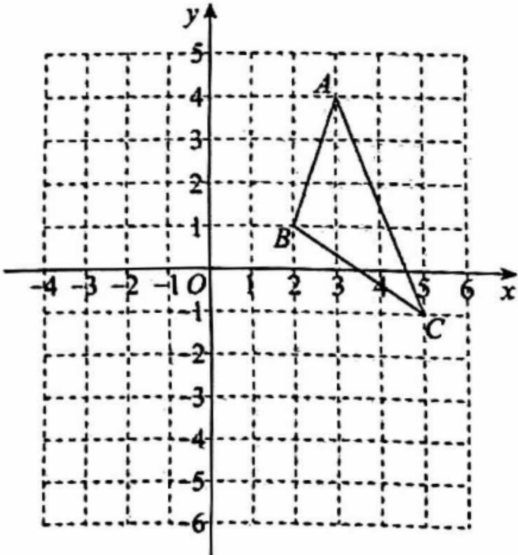
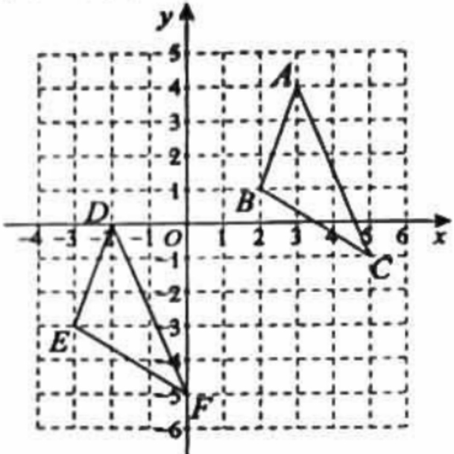

如图，在平面直角坐标系 $xOy$ 中，三角形 $ABC$ 三个顶点的坐标分别是 A（3，4），B（2，1），C（5，-1）。将三角形 ABC 先向左平移 5 个单位长度，再向下平移 4 个单位长度后得到三角形 DEF，其中点 D，E，F 分别为点 A，B，C 的对应点.

(1) 在图中画出三角形 DEF；

(2) 求三角形 $ABC$ 的面积;

(3) 若三角形 $ABC$ 内一点 $P$ 经过上述平移后的对应点为 $Q(m, n)$, 直接写出点 $P$ 的坐标（用含 $m, n$ 的式子表示）.

> [!question]- 点击查看答案与解析
> 【答案】
> （1）如图：
> 
> 
> 
> （2）$S_{\triangle ABC} = \frac{11}{2}$
> （3）$P(m+5, n+4)$
> 【解析】
> （2）利用割补法：$S_{\triangle ABC} = \frac{1}{2} \times (3+5) \times 3 - \frac{1}{2} \times 1 \times 3 - \frac{1}{2} \times 2 \times 5 = \frac{11}{2}$。
> （3）平移规律：左移 5 减 x，下移 4 减 y，则 $P$ 到 $Q$ 为 $(x-5, y-4)$，故 $Q(m,n)$ 对应的 $P$ 为 $(m+5, n+4)$。
> 【考点】坐标与平移 → [[【初中数学知识点体系-人教版】#7-4 平移]]
