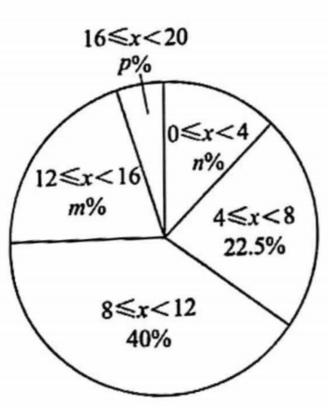
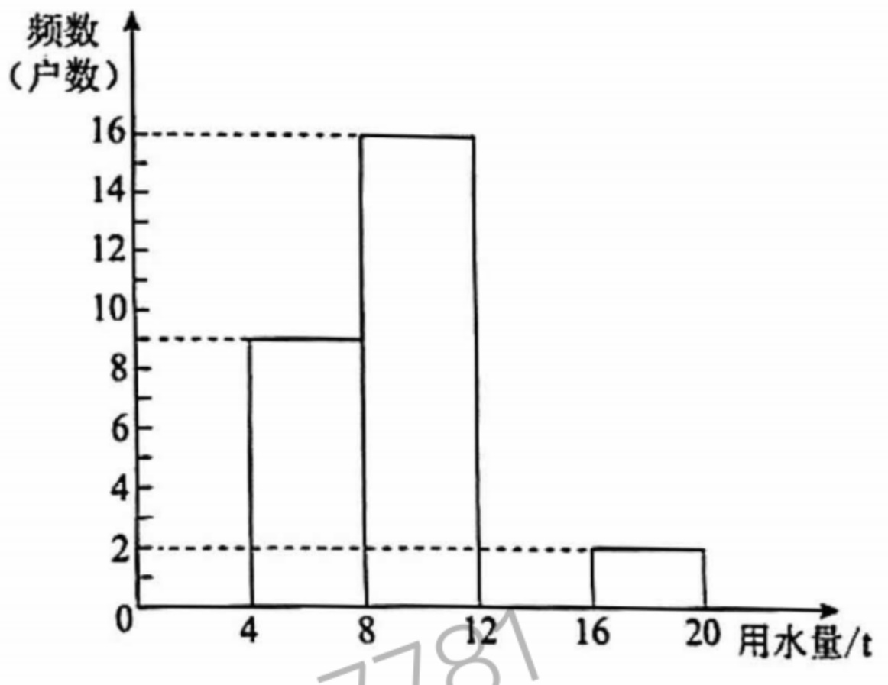

《北京市节水条例》自2023年3月1日起实施。学校组织了"珍惜水资源，节水从我做起"的活动，号召大家节约用水。为了解所居住小区家庭用水的情况，小芸从该小区的住户中随机抽取了部分家庭，获得了这些家庭4月份用水量（单位：t）的数据，并对这些数据进行整理和描述。数据分成5组：$0 \leq x < 4$，$4 \leq x < 8$，$8 \leq x < 12$，$12 \leq x < 16$，$16 \leq x < 20$。下面给出了部分信息：

a. 4 月份用水量的数据的扇形图、频数分布直方图分别如图 1，图 2 所示.

图1

图2

b. 4 月份用水量的数据在 $12 \leq x < 16$ 这一组的是：

12 12.5 12.5 13 13 14 15.5 15.5

根据以上信息，回答下列问题：

(1) 小芸共抽取了___ 户家庭进行调查；

(2) 扇形图中，$8 \leq x < 12$ 这一组所对应的扇形的圆心角的度数为___°，$n\% = \_\_\_\_\_\_\%$;

(3) 补全频数分布直方图；

(4) 请你根据小芸的调查结果，估计该小区 480 户家庭中有多少户家庭年用水量超过 180 t.

> [!question]- 点击查看答案与解析
> 【答案】
> （1）40
> （2）144，12.5
> （3）补图略（频数分布直方图中 $12 \leq x < 16$ 组频数为 8）
> （4）48 户
> 【解析】
> （1）由扇形图可知 $4 \leq x < 8$ 组占 30%，频数直方图中该组频数为 12，故总数 $12 \div 30\% = 40$ 户。
> （2）$8 \leq x < 12$ 组频数为 $40 - 2 - 12 - 8 - 4 = 14$，圆心角 $= \frac{14}{40} \times 360^{\circ} = 144^{\circ}$。$n\% = 5 \div 40 = 12.5\%$。
> （4）年用水量超过 180 t 即月均超过 15 t。4 月份用水量超过 15 t 的有 4 户，占比 $\frac{4}{40} = 10\%$，估计全小区 $480 \times 10\% = 48$ 户。
> 【考点】频数分布、用样本估计总体 → [[【初中数学知识点体系-人教版】#12-1 统计调查]]
