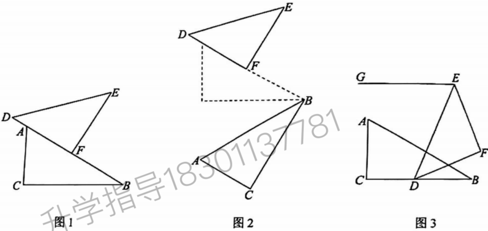
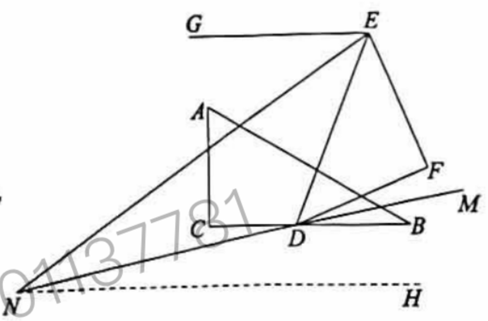

将三角形 ABC 和三角形 DEF 按图 1 所示的方式摆放，其中 $\angle ACB = \angle DFE = 90^{\circ}$，$\angle DEF = \angle EDF = 45^{\circ}$，$\angle ABC = 30^{\circ}$，$\angle BAC = 60^{\circ}$，点 D, A, F, B 在同一条直线上.

(1) 将图 1 中的三角形 ABC 绕点 B 逆时针旋转，且点 A 在直线 DF 的下方.

$①$ 如图2，当 $AC\parallel DF$ 时，求证：$EF\parallel BC$;

$②$ 当 $AC \parallel DE$ 时，直接写出 $\angle FBA$ 的度数；

(2) 将图 1 中的三角形 DEF 绕点 E 逆时针旋转，如图3，当点 D 首次落在边 BC 上时，过点 E 作 $EG∥BC$. 作射线 DM 平分 $\angle FDB$，作射线 EN 平分 $\angle GED$ 交 DM 的反向延长线于点 N，依题意补全图形并求 $\angle END$ 的度数.

> [!question]- 点击查看答案与解析
> 【答案】
> （1）$①$ 证明：$\because AC∥DF$，$\therefore \angle FBC + \angle C = 180^{\circ}$。$\because \angle C=90^{\circ}$，$\therefore \angle FBC = 90^{\circ}$。$\because \angle EFD = 90^{\circ}$，$\therefore \angle EFB = 90^{\circ}$。$\therefore \angle EFB = \angle FBC$，$\therefore EF∥BC$。
> $②$ $105^{\circ}$
> （2）$\angle END = 22.5^{\circ}$
> 【解析】
> （1）$②$ 当 $AC ∥ DE$ 时，$\angle FBA = 105^{\circ}$。
> （2）过点 N 作 $NH ∥ EG$，设 $\angle MDB = \alpha$。由平行线性质和角平分线可推得 $\angle END = 22.5^{\circ}$。
> 
> 【考点】平行线综合 → [[【初中数学知识点体系-人教版】#7-2 平行线]]
