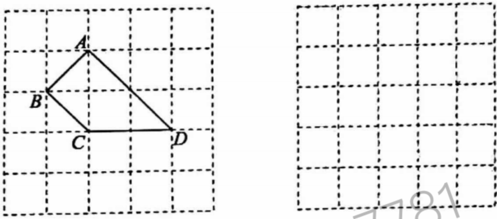
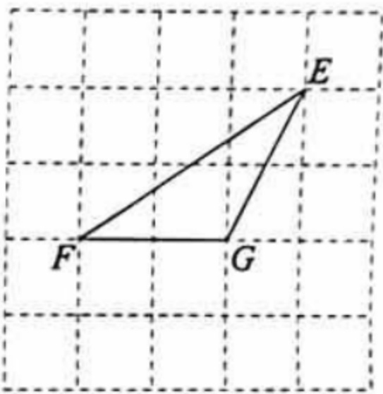

在边长为1的正方形网格中，网格线交点称为格点，顶点都在格点上的多边形称为格点多边形。将格点多边形边上（含顶点）的格点个数记为M，内部的格点个数记为N，其面积记为S，它们满足公式 $S=aM+N+b$。小东忘记了公式中a，b的值，他想到可以借助两个特殊格点多边形求出a，b的值。小东画出一个格点四边形ABCD（如图1），它所对应的M=6，N=1，S=3。

(1) 请在图 2 中画出一个格点三角形EFG，并直接写出它所对应的 M，N，S 的值：

(2) 求 a, b 的值.

图1

图2

> [!question]- 点击查看答案与解析
> 【答案】
> （1）答案不唯一，如图：$M=4$，$N=1$，$S=2$。
> （2）$\begin{cases} a=\frac{1}{2} \\ b=-1 \end{cases}$
> 【解析】
> （1）画一个格点三角形，如直角边为2的等腰直角三角形，边上格点4个，内部格点1个，面积 $S=2$。
> （2）将四边形 ABCD 的数据 $M=6,N=1,S=3$ 和三角形 EFG 的数据 $M=4,N=1,S=2$ 分别代入 $S=aM+N+b$：
> $\begin{cases} 3=6a+1+b \\ 2=4a+1+b \end{cases}$，解得 $\begin{cases} a=\frac{1}{2} \\ b=-1 \end{cases}$。
> 
> 【考点】格点多边形面积公式 → [[【初中数学知识点体系-人教版】#8-3 实数及其简单运算]]
