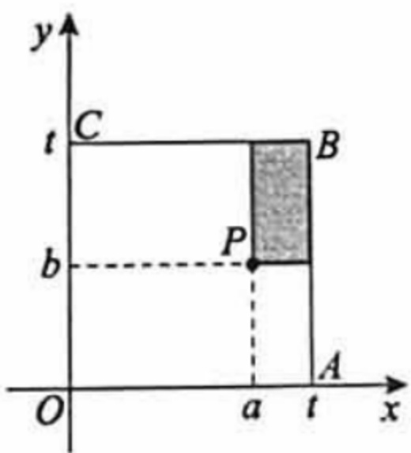

在平面直角坐标系 xOy 中，已知点 $P(x_1, y_1)$，$Q(x_2, y_2)$，给出如下定义：$M[P, Q] = \frac{1}{2}(x_1 + x_2 - |x_1 - x_2|) + \frac{1}{2}(y_1 + y_2 - |y_1 - y_2|)$。

(1) 已知点 P(1,0).

$①$ 若点 $Q$ 与点 $P$ 重合，则 $M[P, Q] =$ ___ ；

$②$ 若点 $Q(3, -1)$，则 $M[P, Q] =$ ___ ；

(2) 正方形 OABC 四个顶点的坐标分别是 $O(0,0)$，$A(t,0)$，$B(t,t)$，$C(0,t)$，其中 t>0。在正方形 OABC 内部有一点 $P(a,b)$，动点 Q 在正方形 OABC 的边上及其内部运动。若 $M[P,Q]=a+b$，求所有满足条件的点 Q 组成的图形的面积（用含 a, b, t 的式子表示）；

(3) 若点 $P(1,2)$，$Q(k,5-k)$，$M[P,Q]>0$，且 $M[P,Q]$ 为奇数，直接写出 k 的取值范围.

> [!question]- 点击查看答案与解析
> 【答案】
> （1）$①$ 1；$②$ 0
> （2）$(t-a)(t-b)$
> （3）$1 \leq k \leq 3$ 或 $k=-1, 5$
> 【解析】
> （1）$①$ $Q$ 与 $P$ 重合，$M[P,P] = \frac{1}{2}(1+1-|1-1|) + \frac{1}{2}(0+0-|0-0|) = 1$。
> $②$ $M[P,Q] = \frac{1}{2}(1+3-|1-3|) + \frac{1}{2}(0-1-|0+1|) = \frac{1}{2}(4-2) + \frac{1}{2}(-1-1) = 1-1 = 0$。
> （2）$M[P,Q] = \frac{1}{2}(a+x-|a-x|) + \frac{1}{2}(b+y-|b-y|)$。由 $M[P,Q]=a+b$ 得 $x \geq a$ 且 $y \geq b$，即 Q 在以 $(a,b)$ 为左下角、$(t,t)$ 为右上角的矩形区域内，面积为 $(t-a)(t-b)$。
> （3）$M[P,Q] = \frac{1}{2}(1+k-|1-k|) + \frac{1}{2}(2+5-k-|2-(5-k)|)$，化简得 $M[P,Q] = \min(1,k) + \min(2,5-k)$。要求 $M[P,Q] > 0$ 且为奇数，解得 $1 \leq k \leq 3$ 或 $k=-1, 5$。
> 
> 【考点】新定义运算 → [[【初中数学知识点体系-人教版】#8-3 实数及其简单运算]]
