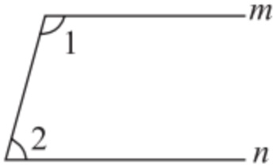

如图,若 $m \parallel n$, $\angle 1 = 105^{\circ}$,则 $\angle 2 =$

A. $55^{\circ}$

B. $60^{\circ}$

C. $65^{\circ}$

D. $75^{\circ}$

> [!question]- 点击查看答案与解析
> **【答案】** D
> 
> **【考点】** 平行线的性质 [[【初中数学知识点体系-人教版】#7-2 平行线]]
> 
> **【解析】**
> 如图,$m\parallel n$,$\angle 1=105^\circ$,$\angle 1$ 与 $\angle 2$ 是同旁内角。根据平行线的性质:两直线平行,同旁内角互补。所以 $\angle 1+\angle 2=180^\circ$,$\angle 2=180^\circ-105^\circ=75^\circ$。
> - 选项A:$55^\circ$ 错误;
> - 选项B:$60^\circ$ 错误;
> - 选项C:$65^\circ$ 错误;
> - 选项D:$75^\circ$ 正确。
> 
> **【易错点】** 混淆同位角、内错角、同旁内角的关系,或计算错误。
