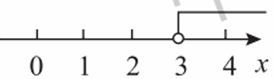
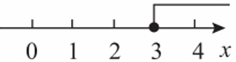
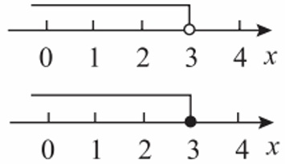

不等式 $x - 3 \geq 0$ 的解集在数轴上可以表示为

A.

C.

B 和 D

> [!question]- 点击查看答案与解析
> **【答案】** C
>
> **【考点】** 不等式解集的数轴表示 [[【初中数学知识点体系-人教版】#11-2 一元一次不等式]]
>
> **【解析】**
> 不等式 $x-3\geqslant 0$ 的解集为 $x\geqslant 3$。在数轴上表示时,3 处应为实心圆点(表示包含 3),方向向右(表示大于等于 3 的所有数)。
> - 选项A:错误,不符合 $x\geqslant 3$ 的表示;
> - 选项B:错误;
> - 选项C:正确,3 处实心圆点,方向向右;
> - 选项D:错误。
>
> **【易错点】** 混淆实心圆点($\geqslant$ 或 $\leqslant$)与空心圆圈($>$ 或 $<$)的用法,或方向表示错误。
