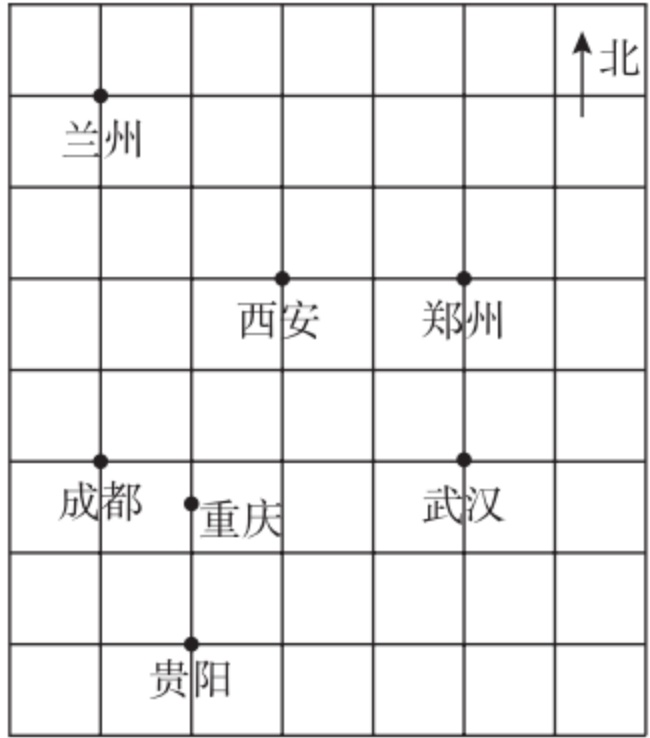

小华同学在做家庭暑期旅游攻略时，绘制了西安市周边部分城市位置的示意图，如右图所示，分别以正东，正北方向为 x 轴，y 轴的正方向建立平面直角坐标系。如果表示武汉市的点的坐标为 $(4, 0)$，表示西安市的点的坐标为 $(2, 2)$，则表示贵阳市的点的坐标是

A. $(0, 0)$

B. $(1, -2)$

C. $(3, 1)$

D. $(-2, 1)$

> [!question]- 点击查看答案与解析
> **【答案】** D
> 
> **【考点】** 用坐标描述平面内点的位置 [[【初中数学知识点体系-人教版】#9-1 用坐标描述平面内点的位置]]
> 
> **【解析】**
> 根据题意，武汉市的坐标为 $(4,0)$，西安市的坐标为 $(2,2)$。以正东为 $x$ 轴正方向，正北为 $y$ 轴正方向。
> 
> 由图可知，贵阳市位于西安市的左上方。通过比较位置关系，贵阳市相对于西安市向左移动 4 个单位，向下移动 1 个单位（或从图中直接读取），可得贵阳市的坐标为 $(-2,1)$。
> 
> - 选项A：$(0,0)$ 错误；
> - 选项B：$(1,-2)$ 错误；
> - 选项C：$(3,1)$ 错误；
> - 选项D：$(-2,1)$ 正确。
> 
> **【易错点】** 不能根据已知点的坐标建立正确的坐标系，或读取位置时方向判断错误。
