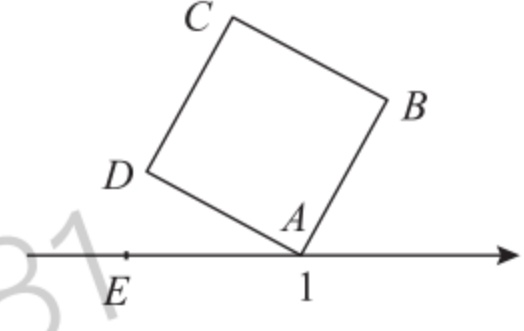

如图，正方形 $ABCD$ 的面积为 3，顶点 $A$ 在数轴上，且点 $A$ 表示的数为 1，数轴上有一点 $E$ 在点 $A$ 的左侧，若 $AD = AE$，则点 $E$ 表示的数为

A. $1 - \sqrt{3}$

B. $-1$

C. $-\sqrt{3}$

D. 0

> [!question]- 点击查看答案与解析
> **【答案】** A
> 
> **【考点】** 实数与数轴 [[【初中数学知识点体系-人教版】#8-3 实数及其简单运算]]
> 
> **【解析】**
> 正方形 $ABCD$ 的面积为 $3$，所以边长 $AD=\sqrt{3}$。
> 点 $A$ 在数轴上表示的数为 $1$，$AD=AE=\sqrt{3}$，点 $E$ 在点 $A$ 的左侧。
> 所以点 $E$ 表示的数为 $1-\sqrt{3}$。
> 
> - 选项A：$1-\sqrt{3}$ 正确；
> - 选项B：$-1$ 错误；
> - 选项C：$-\sqrt{3}$ 错误，这是以原点为起点的距离；
> - 选项D：$0$ 错误。
> 
> **【易错点】** 没有正确理解点 $A$ 表示的数为 $1$，或搞错点 $E$ 在 $A$ 的左侧需要用减法。
