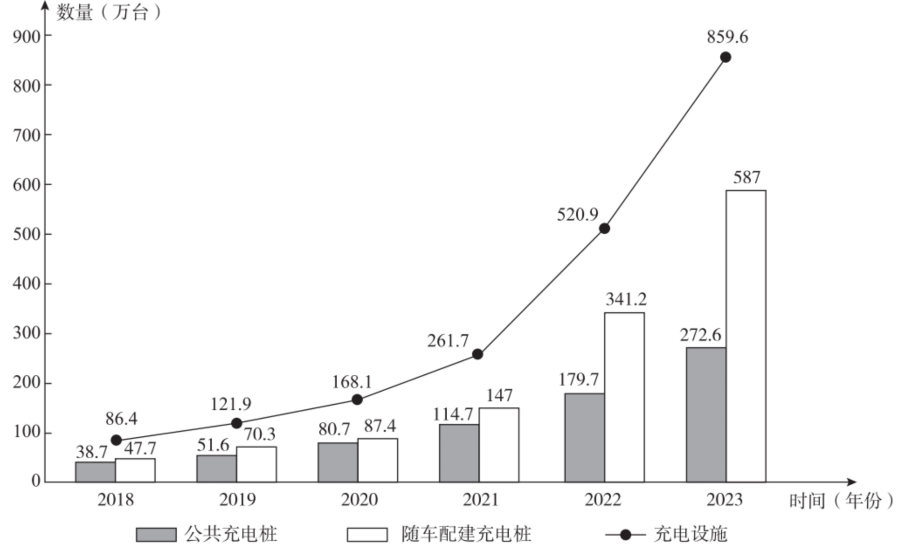

近年来汽车工业不断进行技术改革和升级，新能源汽车走进千家万户，与之配套的充电设施也在不断建设中，从充电设施的应用场景看，充电设施可分为私人随车配建充电桩和公共充电桩。据新能源汽车国家大数据联盟统计，2018—2023 年我国充电设施累计数量情况如下图所示。

根据上述信息，给出下列四个结论：

$①$ 2018—2023年，每年充电设施累计数量呈上升趋势；

$②$ 2023年新增公共充电桩数量超过90万台；

$③$ 2018—2023年，每年新增的随车配建充电桩数量逐年上升；

$④$ 2018—2023 年，随车配建充电桩累计数量占充电设施累计数量的百分比最高的年份是 2023 年. 其中所有正确的结论是

A. $②③$

B. $①②④$

C. $①②③$

D. $①③④$

> [!question]- 点击查看答案与解析
> **【答案】** B
> 
> **【考点】** 统计图表的阅读与分析 [[【初中数学知识点体系-人教版】#12-2 用统计图描述数据]]
> 
> **【解析】**
> 逐一分析四个结论：
> - 结论$①$：2018—2023 年，每年充电设施累计数量呈上升趋势，从图表数据可以看出逐年递增，正确；
> - 结论$②$：2023 年新增公共充电桩数量。从图表中读取 2022 年和 2023 年的公共充电桩数据，差值超过 90 万台，正确；
> - 结论$③$：2018—2023 年，每年新增的随车配建充电桩数量逐年上升。需要计算每年的新增量，实际上并非逐年上升，错误；
> - 结论$④$：2018—2023 年，随车配建充电桩累计数量占比最高的年份是 2023 年。通过计算各年份的占比可知 2023 年最高，正确。
> 
> 所以正确的结论是$①②④$。
> - 选项A：$②③$ 错误；
> - 选项B：$①②④$ 正确；
> - 选项C：$①②③$ 错误；
> - 选项D：$①③④$ 错误。
> 
> **【易错点】** 不能正确从统计图中提取数据，或对"新增"与"累计"概念混淆，计算错误。
