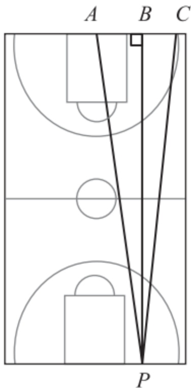

如图，小明在长方形的篮球场上沿直线进行折返跑训练，他从场地一边的P点处出发，选择到对面的 ___ （填A，B或C）点处折返一次回到 P 点时，跑过的路程最短.

> [!question]- 点击查看答案与解析
> **【答案】** B
> 
> **【考点】** 垂线段最短 [[【初中数学知识点体系-人教版】#7-1 相交线]]
> 
> **【解析】**
> 从点 $P$ 到对面直线的距离，以垂线段最短。观察图形，$PB$ 与对面直线垂直（或最接近垂直），所以到 $B$ 点折返跑过的路程最短。根据"垂线段最短"的几何原理，从直线外一点到这条直线的所有线段中，垂线段最短。
> 
> **【易错点】** 不能正确识别垂线段，或凭感觉选择而非运用几何原理。
