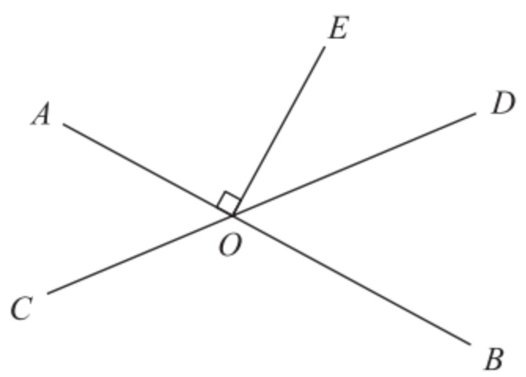

如图，直线 AB，CD 相交于点 O，OE⊥AB，O 为垂足，如果 $\angle EOD = 38^\circ$，则 $\angle COB =$ ___ 。

> [!question]- 点击查看答案与解析
> **【答案】** $128^\circ$
> 
> **【考点】** 垂直定义、对顶角、邻补角 [[【初中数学知识点体系-人教版】#7-1 相交线]]
> 
> **【解析】**
> 已知 $OE\perp AB$，所以 $\angle EOB=90^\circ$。
> 又 $\angle EOD=38^\circ$，则 $\angle BOD=\angle EOB-\angle EOD=90^\circ-38^\circ=52^\circ$。
> 因为 $\angle COB$ 与 $\angle BOD$ 是邻补角（或 $\angle COB$ 与 $\angle AOD$ 是对顶角），
> 所以 $\angle COB=180^\circ-\angle BOD=180^\circ-52^\circ=128^\circ$。
> 
> 或：$\angle AOE=90^\circ$（垂直定义），$\angle AOD=\angle AOE+\angle EOD=90^\circ+38^\circ=128^\circ$，
> 由对顶角相等得 $\angle COB=\angle AOD=128^\circ$。
> 
> **【易错点】** 搞错角与角之间的位置关系（邻补角、对顶角），或计算错误。
