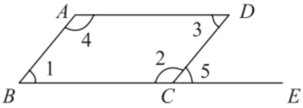

我们知道，由角的数量关系可得两条直线的位置关系。如图，为使 $AB \parallel DC$ 成立，请写出一组角的数量关系作为条件：___ .

> [!question]- 点击查看答案与解析
> **【答案】** $\angle A=\angle C$（或 $\angle B=\angle D$ 或 $\angle A+\angle D=180^\circ$ 或 $\angle B+\angle C=180^\circ$ 等，写出一组即可）
> 
> **【考点】** 平行线的判定 [[【初中数学知识点体系-人教版】#7-2 平行线]]
> 
> **【解析】**
> 要使 $AB\parallel DC$，可以利用平行线的判定条件：
> - 同位角相等，两直线平行；
> - 内错角相等，两直线平行；
> - 同旁内角互补，两直线平行。
> 
> 对于四边形 $ABCD$：
> - 若 $\angle A=\angle C$ 且 $\angle B=\angle D$，则四边形是平行四边形，$AB\parallel DC$；
> - 若 $\angle A+\angle D=180^\circ$（同旁内角互补），则 $AB\parallel DC$；
> - 若 $\angle B+\angle C=180^\circ$（同旁内角互补），则 $AB\parallel DC$。
> 
> 答案不唯一，任写一组即可。
> 
> **【易错点】** 没有正确识别同位角、内错角、同旁内角，或平行线判定条件记忆不清。
