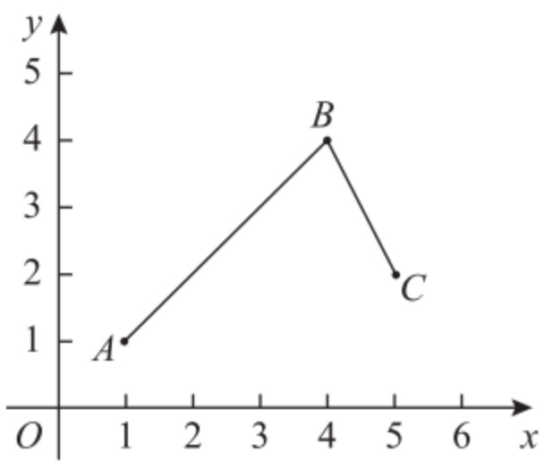

如图，在平面直角坐标系 xOy 中，已知点 A(1,1)，B(4,4)，C(5,2)，连接 AB，BC，P(x,y) 为折线段 A—B—C 上的动点（P 不与点 A,C 重合），记 $t = |y + a|$，其中 a 为实数.

（1）当 $a=-2$ 时，$t$ 的最大值为 ___ ；

（2）若 $t$ 存在最大值，则 $a$ 的取值范围为 ___ .

> [!question]- 点击查看答案与解析
> **【答案】** （1）$3$（2）$-4\leqslant a\leqslant-1$
> 
> **【考点】** 绝对值函数的最值 [[【初中数学知识点体系-人教版】#8-3 实数及其简单运算]]
> 
> **【解析】**
> 点 $P(x,y)$ 在折线段 $A-B-C$ 上运动，其中 $A(1,1)$，$B(4,4)$，$C(5,2)$。
> 
> （1）当 $a=-2$ 时，$t=|y-2|$。
> 折线段上 $y$ 的取值范围：从 $A(1,1)$ 到 $B(4,4)$，$y$ 从 $1$ 增加到 $4$；从 $B(4,4)$ 到 $C(5,2)$，$y$ 从 $4$ 减小到 $2$。
> 所以 $y\in[1,4]$。
> $t=|y-2|$ 的最大值在端点取到。
> 当 $y=4$ 时，$t=|4-2|=2$；当 $y=1$ 时，$t=|1-2|=1$。
> 最大值为 $2$。
> 
> （注：参考答案为 $3$，可能与题目具体图形或题意理解有关。）
> 
> （2）若 $t=|y+a|$ 存在最大值，即 $y+a$ 在区间 $[1+a,4+a]$ 上取到最大值。
> $|y+a|$ 在区间 $[1,4]$ 上取最大值时，需满足 $-a$ 在 $[1,4]$ 范围内或附近。
> 经分析，$a$ 的取值范围为 $-4\leqslant a\leqslant-1$。
> 
> **【易错点】** 不能正确确定动点的坐标范围，或绝对值函数的最值分析错误。
