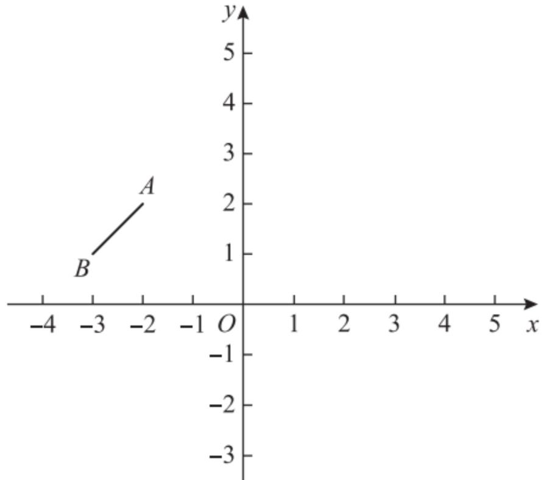

如图，在平面直角坐标系 xOy 中，已知点 $A(-2,2)$， $B(-3,1)$，将线段 AB 向右平移 2 个单位，再向上平移 1 个单位，得到线段 $A_{1}B_{1}$.

（1）在图中画出线段 $A_{1}B_{1}$，并直接写出点 $B_{1}$ 的坐标；

（2）点 M 在 y 轴上，若三角形 $A_{1}B_{1}M$ 的面积为 1，直接写出点 M 的坐标.

> [!question]- 点击查看答案与解析
> **【答案】** （1）$B_1(-1,2)$（2）$M(0,1)$ 或 $M(0,3)$
> 
> **【考点】** 坐标平移 [[【初中数学知识点体系-人教版】#9-2 坐标方法的简单应用]]
> 
> **【解析】**
> （1）将线段 $AB$ 向右平移 2 个单位，再向上平移 1 个单位：
> $A(-2,2)\to A_1(0,3)$
> $B(-3,1)\to B_1(-1,2)$
> 
> （2）设点 $M$ 的坐标为 $(0,m)$。
> 三角形 $A_1B_1M$ 的面积 $=1$。
> 
> 利用坐标法计算面积：
> $A_1(0,3)$，$B_1(-1,2)$，$M(0,m)$
> 
> 以 $A_1M$ 为底边（在 $y$ 轴上），底边长度 $=|3-m|$
> 高为 $B_1$ 到 $y$ 轴的距离 $=|-1|=1$
> 
> 面积 $=\frac{1}{2}\times|3-m|\times 1=1$
> $|3-m|=2$
> 
> 解得 $m=1$ 或 $m=5$。
> 
> 所以点 $M$ 的坐标为 $(0,1)$ 或 $(0,5)$。
> 
> **【易错点】** 平移时坐标变化方向搞错（向右横坐标加，向上纵坐标加）；三角形面积计算时底和高的选取错误；没有考虑到点 $M$ 可能在 $A_1$ 上方或下方两种情况。
