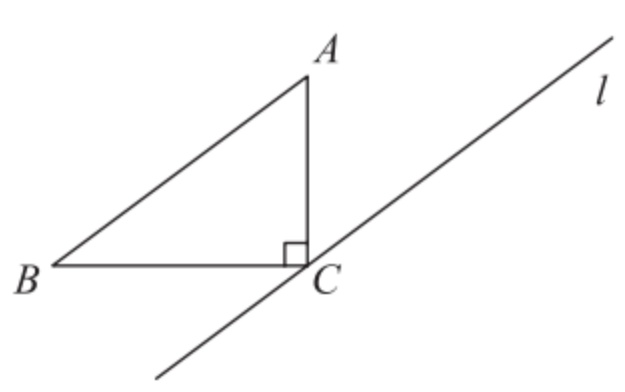

如图，三角形 ABC 中， $\angle ACB = 90^{\circ}$，过点 C 作 AB 的平行线 l，在线段 AB 上任取一点 D（不与点 A，B 重合），过点 D 作 AC 的垂线交 AC 于点 E，交直线 l 于点 F.

（1）依题意补全图形；

（2）求证： $\angle B = \angle CFE$.

> [!question]- 点击查看答案与解析
> **【答案】** （1）略（2）证明见解析
> 
> **【考点】** 平行线的判定与性质 [[【初中数学知识点体系-人教版】#7-2 平行线]]
> 
> **【解析】**
> （1）依题意补全图形（略）。
> 
> （2）证明：
> $\because DF\perp AC$，$\angle ACB=90^\circ$（已知）
> $\therefore DF\parallel BC$（垂直于同一条直线的两条直线平行）
> $\therefore \angle B=\angle ADF$（两直线平行，同位角相等）
> $\because l\parallel AB$（已知）
> $\therefore \angle ADF=\angle CFE$（两直线平行，内错角相等）
> $\therefore \angle B=\angle CFE$（等量代换）
> 
> **【易错点】** 不能正确运用平行线的判定和性质进行推理；证明过程逻辑链条不完整。
