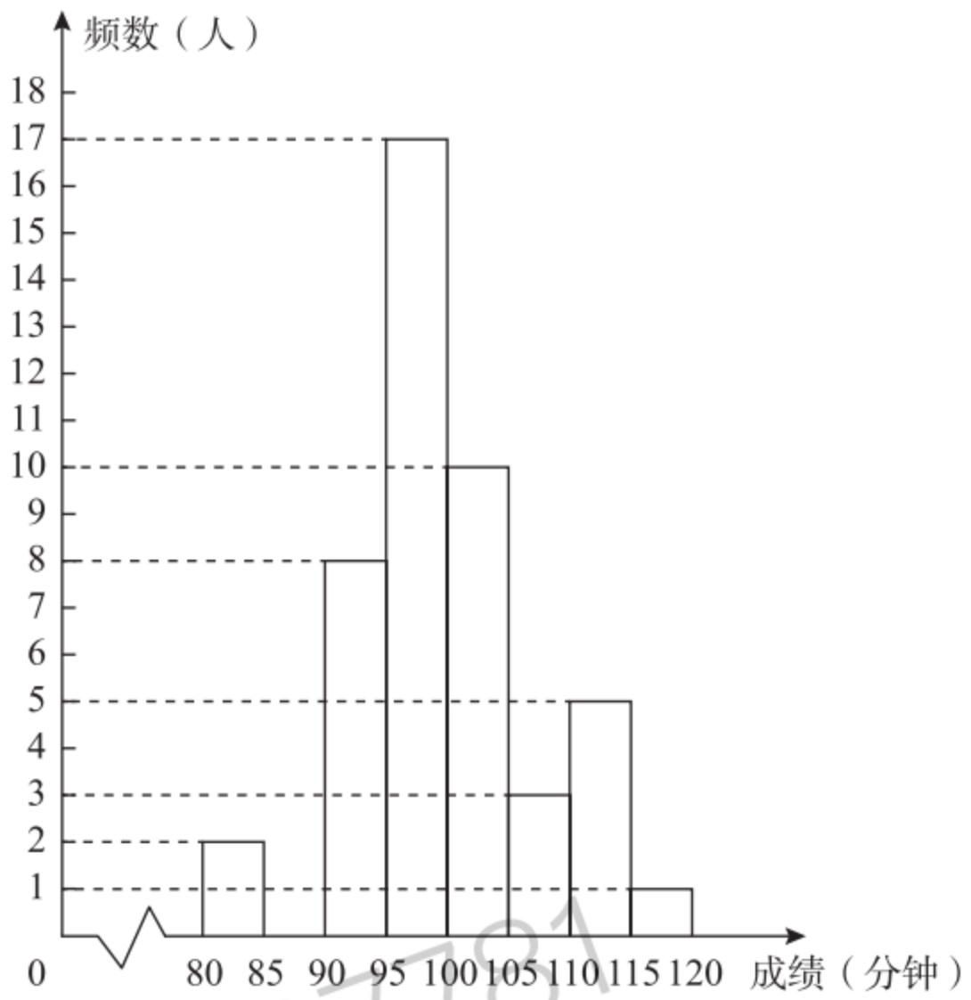
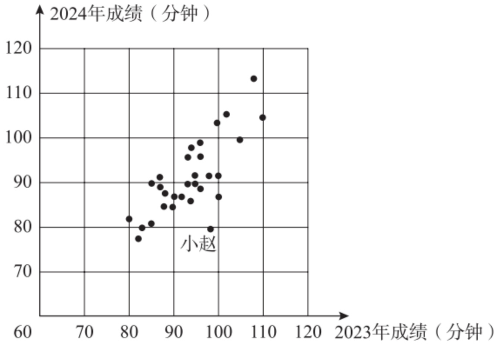

为了解某长跑俱乐部成员的跑步成绩情况，某学校的长跑社团收集了该俱乐部 2023 年和 2024 年半程马拉松 "大师赛" 的比赛成绩，分为两个研究小组进行调查研究.

（1）第一个研究小组随机抽取了该俱乐部 2023 年一些成员的比赛成绩，部分统计结果如下：

| 成绩x（分钟）      | 频数（人） | 频率   |
| ------------ | ----- | ---- |
| 80&lt;x≤85   | 2     | 0.04 |
| 85&lt;x≤90   |       | 0.08 |
| 90&lt;x≤95   | 8     |      |
| 95&lt;x≤100  | 17    | 0.34 |
| 100&lt;x≤105 | 10    | 0.20 |
| 105&lt;x≤110 | 3     | 0.06 |
| 110&lt;x≤115 | 5     | 0.10 |
| 115&lt;x≤120 | 1     | 0.02 |
| 合计           |       | 1    |

$①$ 请把上面的频数分布直方图补充完整；

$②$ 在 2023 年，该俱乐部共有 280 名成员，根据上面的统计结果估计该年俱乐部中成绩 x 满足 $90 < x \leq 95$ 的人数为 ___ （结果精确到个位）；

(2) 第二个研究小组从该俱乐部 2023 年和 2024 年均参加了半程马拉松 "大师赛" 的选手中抽取了 30 名选手的跑步成绩，绘制了统计图（如右图所示）.

请根据右图解答下面的问题:

$①$ 小赵 2024 年的比赛用时比 2023 年的比赛用时 ___ （填"多""少"）；

$②$ 将这 30 名选手中 2024 年成绩优于 2023 年成绩的人数记为 m，其余选手人数记为 n，则 m ___ n（填">""=""<"）.

> [!question]- 点击查看答案与解析
> **【答案】** （1）①略；②45人；（2）①少；②>
> 
> **【考点】** 频数分布直方图 [[【初中数学知识点体系-人教版】#12-1 统计调查]]
> 
> **【解析】**
> （1）①根据频数分布表，85<x≤90组的频数为4人，补充直方图略。
> 
> ②成绩在90<x≤95的频率为0.16，总人数280人，所以人数为280×0.16=44.8≈45人。
> 
> （2）①从统计图可以看出，小赵2024年的比赛用时比2023年少（成绩更好）。
> 
> ②从图中可以看出，大部分选手2024年成绩优于2023年，所以m>n。
> 
> **【易错点】** 频数与频率的关系计算错误；用样本估计总体时计算错误；不能正确阅读统计图分析数据变化趋势。
