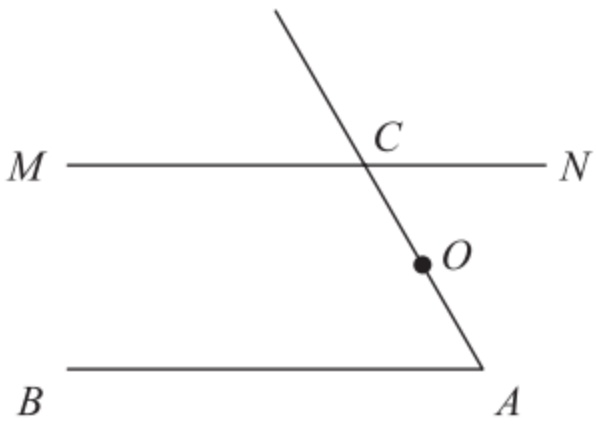
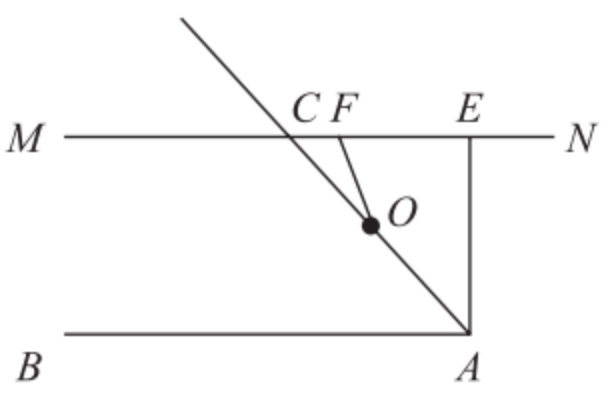
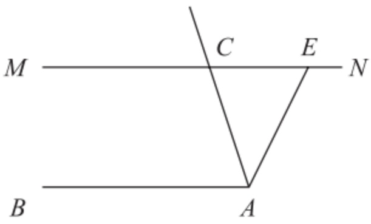

已知 C 为射线 AB 上方一点，过点 C 作 AB 的平行线 MN，点 O 在射线 AC 上运动（不与点 A，C 重合），点 D 在射线 CM 上，连接 OD，满足 $\angle COD = m \angle BAC$（0 < m < 1）.

（1）如图 1，点 O 在线段 AC 上， $\angle BAC = 60^\circ$，若 $m = \frac{1}{2}$，依题意补全图形，并直接写出 $\angle MDO$ 的度数；

（2）点 E，F 在射线 CN 上，连接 AE，OF，满足 $\angle COF = (1 - m) \angle CAE$.

$①$ 如图 2，点 O 在线段 AC 上， $AE \perp AB$，写出一个 m 的值，使得 $\angle MDO + \angle NFO$ 恒为定值，并求出此定值；

$②$ 如图 3，$\angle BAC=70^{\circ}$，$\angle CAE=50^{\circ}$，若直线 $OD$ 和直线 $OF$ 中至少有一条与直线 $AE$ 平行或垂直，直接写出 $m$ 的值。

图 1 

图 2 

图 3 

> [!question]- 点击查看答案与解析
> **【答案】** （1）$\angle MDO=30^\circ$；（2）①$m=\frac{1}{2}$时，定值为$90^\circ$；②$m=\frac{3}{7}$或$m=\frac{2}{7}$
> 
> **【考点】** 平行线性质与角度计算 [[【初中数学知识点体系-人教版】#7-2 平行线]]
> 
> **【解析】**
> （1）已知$\angle BAC=60^\circ$，$m=\frac{1}{2}$，$\angle COD=m\angle BAC=30^\circ$。
> 由平行线性质可推导$\angle MDO=30^\circ$。
> 
> （2）①当$m=\frac{1}{2}$时，通过角度关系分析可得$\angle MDO+\angle NFO=90^\circ$（定值）。
> 
> ②根据平行或垂直条件分类讨论：
> - 若$OD\perp AE$，解得$m=\frac{3}{7}$
> - 若$OF\perp AE$，解得$m=\frac{2}{7}$
> 
> **【易错点】** 几何图形复杂，不能正确识别角度之间的关系；没有进行分类讨论；对平行线性质和垂直条件运用不熟练。
