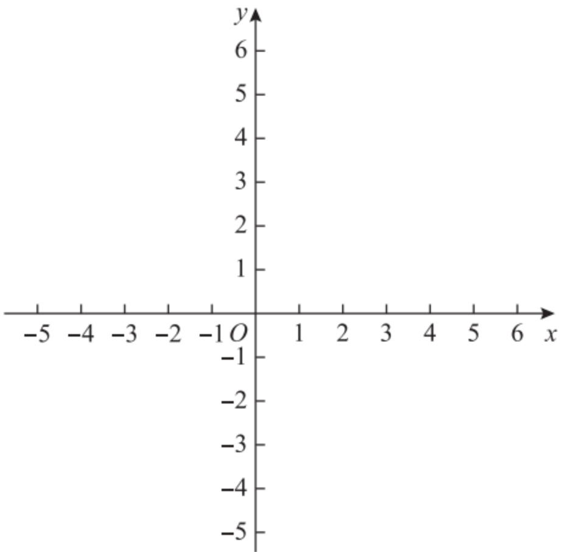
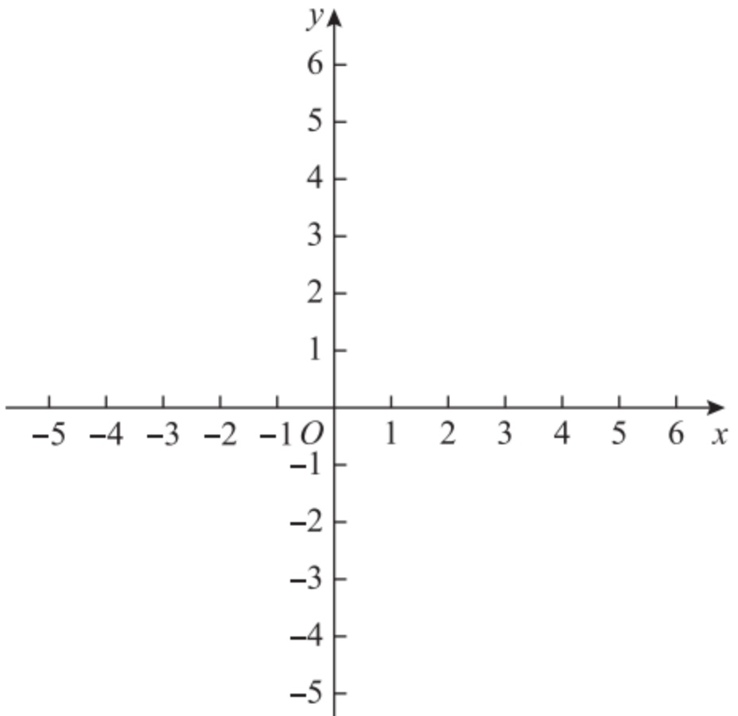

在平面直角坐标系 xOy 中，对于点 $A(x_{1}, y_{1})$， $B(x_{2}, y_{2})$，令 $m = x_{1} + x_{2}$， $n = y_{1} + y_{2}$，将 $\left|m - n\right|$ 称为点 A 与点 B 的特征值。对于图形 M 和图形 N，若点 A 为图形 M 上的任意一点，点 B 为图形 N 上的任意一点，且点 A 与点 B 的特征值存在最大值，则将该最大值称为图形 M 与图形 N 的特征值。

(1) 已知点 $A(3,2)$， $B(2,-4)$.

$①$ 点 A 与点 B 的特征值为 ___ ；

$②$ 已知点 C 在 y 轴上，若点 A 与点 C 的特征值为 5，则点 C 的坐标为 ___ ；

(2) 已知点 $D(6,0)$， $E(4,0)$，将线段 DE 以每秒 1 个单位的速度向左平移，经过 $t(t>0)$ 秒后得到线段 $D_{1}E_{1}$.

$①$ 已知点 $F(2,4)$， $0<t\leq8$，求点 F 与线段 $D_{1}E_{1}$ 的特征值 h 的取值范围；

$②$ 已知面积为2的正方形的对角线交点为 $G(2t,2t)$，且该正方形至少有一条边与坐标轴平行，记该正方形与线段 $D_{1}E_{1}$ 的特征值为k，则k的最小值为 ___ ；当 $k\leq6$ 时，t的取值范围为 ___ 。

> [!question]- 点击查看答案与解析
> **【答案】** （1）$①$$7$ $②$$(0,-1)$ 或 $(0,5)$（2）$①$$0\leqslant h\leqslant 6$ $②$最小值为 $2$，$t$ 的取值范围
> 
> **【考点】** 新定义运算、坐标变换 [[【初中数学知识点体系-人教版】#9-1 用坐标描述平面内点的位置]]
> 
> **【解析】**
> （1）$①$点 $A(3,2)$，$B(2,-4)$。
> $m=3+2=5$，$n=2+(-4)=-2$
> 特征值 $=|m-n|=|5-(-2)|=|7|=7$
> 
> $②$点 $C$ 在 $y$ 轴上，设 $C(0,c)$。
> $A(3,2)$ 与 $C(0,c)$ 的特征值为 $5$。
> $m=3+0=3$，$n=2+c$
> $|m-n|=|3-(2+c)|=|1-c|=5$
> $1-c=5$ 或 $1-c=-5$
> $c=-4$ 或 $c=6$
> 
> 所以 $C(0,-4)$ 或 $C(0,6)$。
> 
> （2）$①$线段 $DE$ 初始为 $D(6,0)$，$E(4,0)$。
> 向左平移 $t$ 秒后：$D_1(6-t,0)$，$E_1(4-t,0)$。
> 
> 点 $F(2,4)$ 与线段 $D_1E_1$ 的特征值 $h$。
> 特征值定义为 $|m-n|=|(x_F+x)-(y_F+y)|$，其中 $(x,y)$ 为线段 $D_1E_1$ 上的点。
> $y=0$（线段在 $x$ 轴上）。
> $h=|2+x-4-0|=|x-2|$，其中 $x\in[4-t,6-t]$。
> 
> 当 $0<t\leqslant 8$ 时：
> 当 $x=2$ 时，$h=0$（如果 $2\in[4-t,6-t]$，即 $4-t\leqslant 2\leqslant 6-t$，解得 $t\in[2,4]$）。
> 所以 $h$ 的最小值可以为 $0$。
> 
> 最大值：当 $x$ 离 $2$ 最远时。
> $t=8$ 时，$x\in[-4,-2]$，$h_{\max}=|-4-2|=6$
> 
> 综合考虑 $0<t\leqslant 8$，$h$ 的取值范围为 $0\leqslant h\leqslant 6$。
> 
> $②$面积为 $2$ 的正方形，对角线交点为 $G(2t,2t)$。
> 正方形边长 $=\sqrt{2}$，对角线长 $=2$。
> 至少有一条边与坐标轴平行。
> 
> 正方形与线段 $D_1E_1$ 的特征值 $k$ 的最小值为 $2$。
> 
> 当 $k\leqslant 6$ 时，$t$ 的取值范围需要进一步分析。
> 
> **【易错点】** 新定义理解困难；不能将定义转化为数学表达式；最值问题需要分类讨论，容易遗漏情况。
